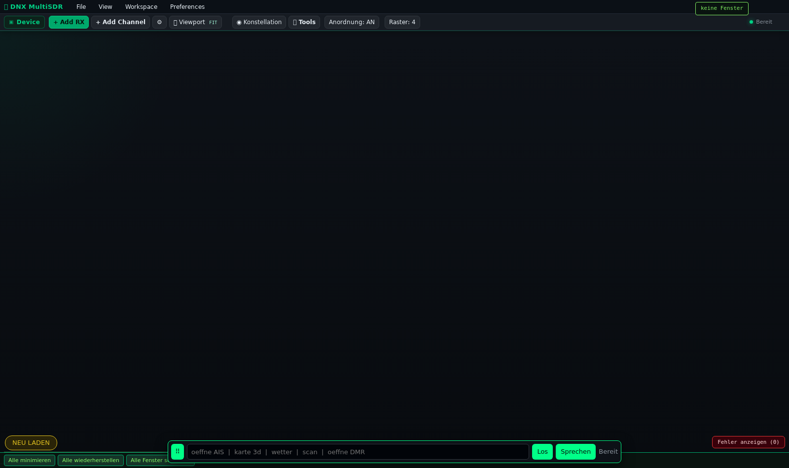

# DNX MultiSDR — Beta

**Umfang und Funktionen** | Stand: November 2026 | Status: **Beta**

> ⚠️ **Wichtiger Hinweis vorab — bitte vollständig lesen.**
> DNX MultiSDR ist ein privates Hobbyprojekt. Es gibt **keinen öffentlichen Support**,
> keine Garantie und keine Gewährleistung, weder ausdrücklich noch stillschweigend.
> Die Nutzung erfolgt **ausschließlich auf eigene Gefahr** – rechtlich wie technisch.
> Der Autor distanziert sich von jeglicher rechtlicher Verantwortung, insbesondere
> hinsichtlich möglicher Strafverfolgung, Rechtsverstößen und Urheberrechtsfragen.
> Details: [docs/disclaimer.md](docs/disclaimer.md)

---

## Was ist DNX MultiSDR?

DNX MultiSDR ist eine umfangreiche Funk- und Datenplattform rund um Software Defined
Radio (RTL-SDR, Airspy u. a.), die ich aus reinem Interesse und für das gemeinsame
Hobby Funk entwickelt habe. Sie verbindet eine moderne, dunkle Browser-Bedienoberfläche
mit leistungsfähigen Empfangs-, Dekodier-, Kartierungs- und Wettermodulen:

- **Empfang & Demodulation** für analoge und digitale Modi (u. a. NFM, DMR, D-STAR, TETRA, P25, NXDN, M17, YSF, FSK, PSK31, SSTV, HF-Fax …)
- **Satelliten-Tracking** (Live-Orbit, Passagen, 3D-Orbit-Ansicht, Polar/Arktis + Antarktis, Sky-Addon mit Himmelskörper-Positionen)
- **Wetterzentrale** mit DWD-Warnungen, Radar + Blitzen, Karten (2D/3D), Wetterdaten-Tabellen und HF-Fax-Empfang von Wetterkarten
- **Decoder-Suite** (Multidecoder-Monitor, Universal-Decoder, EAS-Notfallalarm-Monitor, Radiosonden-Decoder, Frequenz-Scanner/-Manager)
- **Karten**: Welt-Frequenzdatenbank (≈ 29.000 Einträge), Band-Browser, 2D/3D-Karten (OpenStreetMap/Leaflet, Cesium)
- **Sprache & Assistent**: Lokale Befehlsleiste mit Sprachsteuerung ("Los" / "Sprechen" / "Bereit"), lokaler KI-Stack (Ollama) — optional
- **Arbeitsbereiche & Fenster-Management**: Raster-Anordnung, Kaskade/Kacheln, 4 Arbeitsbereiche, Layout-Import/Export (JSON)

## Was ist das NICHT?

- **Kein Produkt.** Kein Verkauf, keine Dienstleistung, kein Support-Angebot.
- **Keine Weitergabe der Anwendung.** Diese Veröffentlichung enthält **nur Dokumentation und Screenshots** — kein Anwendungscode, keine Binaries, kein Installer.
- **Kein Anspruch auf Vollständigkeit oder Fehlerfreiheit.** Das ist Beta. Dinge ändern sich, Dinge brechen.

## Dokumentation

| Dokument | Inhalt |
|---|---|
| [docs/erste-schritte.md](docs/erste-schritte.md) | Hauptfenster-Tour: Menüleiste, Toolbar, Befehlsleiste, Add RX |
| [docs/decoder.md](docs/decoder.md) | **ADD RX & Decoder im Detail**: jedes Dekoder-Fenster (AIS, DMR, APRS, ADS-B, D-STAR, M17, CW, RTTY, TETRA, P25, ILS, VOR …) mit Screenshot |
| [docs/add-channel.md](docs/add-channel.md) | **ADD Channel im Detail**: Satelliten, Sky, Wetter – jeder Eintrag mit Screenshot |
| [docs/wetter.md](docs/wetter.md) | Wetterzentrale: Radar, Blitzdaten, Warnungen, Einstellungen, HF-Fax |
| [docs/tools.md](docs/tools.md) | **Tools-Menü im Detail**: Welt-DB, Frequenz-Scanner, Frequenz-Manager, Multidecoder, Universal-Decoder, Band-Browser |
| [docs/menues.md](docs/menues.md) | File / View / Workspace / Preferences im Überblick |
| [docs/installation.md](docs/installation.md) | Betrieb mit Docker und ohne Docker, Zusatz-Container und warum |
| [docs/architektur.md](docs/architektur.md) | Warum nicht alles in JavaScript gebaut ist |
| [docs/faq.md](docs/faq.md) | Häufige Fragen (eigene API-Schlüssel, Datenquellen, Offline-Betrieb …) |
| [docs/disclaimer.md](docs/disclaimer.md) | Der vollständige Disclaimer |

## Schnellstart (in eigenen Worten)

1. **Empfänger anbinden** — `+ Add RX`, Gerät wählen (RTL-SDR, Airspy, DSP Test Source, Remote IP:Port), hinzufügen.
2. **Fenster anordnen** — die App ordnet Fenster automatisch im Raster an (Toolbar: `Anordnung: AN`, `Raster: 4`).
3. **Kanal hinzufügen** — `+ Add Channel` öffnet die Kanalpalette (Satelliten / Sky / Wetter).
4. **Werkzeuge** — Menü `Tools` für Scanner, Manager, Decoder und Band-Browser.

## Lizenz & Weiterverbreitung

Diese Dokumentation und die Screenshots stehen unter der **MIT-Lizenz** (siehe [LICENSE](LICENSE)):
nutzen, kopieren, ändern, verbreiten — ausdrücklich auch geändert und verbessert — ist freigegeben.
Die Anwendung selbst ist **nicht** Teil dieser Veröffentlichung.

Der Autor stellt das Projekt aus reinem Hobby und für das gemeinsame Hobby Funk bereit
und **distanziert sich ausdrücklich von jeglicher rechtlichen Verantwortung** rund um
Nutzung, Verbreitung und Abwandlung — siehe [docs/disclaimer.md](docs/disclaimer.md).

---

*Erstellt in Zusammenarbeit mit einem KI-Assistenten. DNX MultiSDR ist ein Freizeitprojekt
von KanotixPinguin und erhebt keinen Anspruch auf geschäftliche Eignung.*
