# ADD Channel im Detail

`+ Add Channel` öffnet die **Kanalpalette** (`Kanal / Fenster`). Sie gliedert sich in
drei Kategorien plus einen eigenen Bereich für RX-gebundene Module:

> **Wichtig:** Die klassischen Dekoder-Fenster (AIS, DMR, APRS, ADS-B, D-STAR, M17,
> CW, RTTY, TETRA, P25, ILS, VOR …) werden **nicht** über diese Palette geöffnet,
> sondern über die **Befehlsleiste** (`oeffne CW`, `oeffne DMR`, …) — siehe
> [decoder.md](decoder.md). In der Palette stehen nur Satelliten, Sky und Wetter.

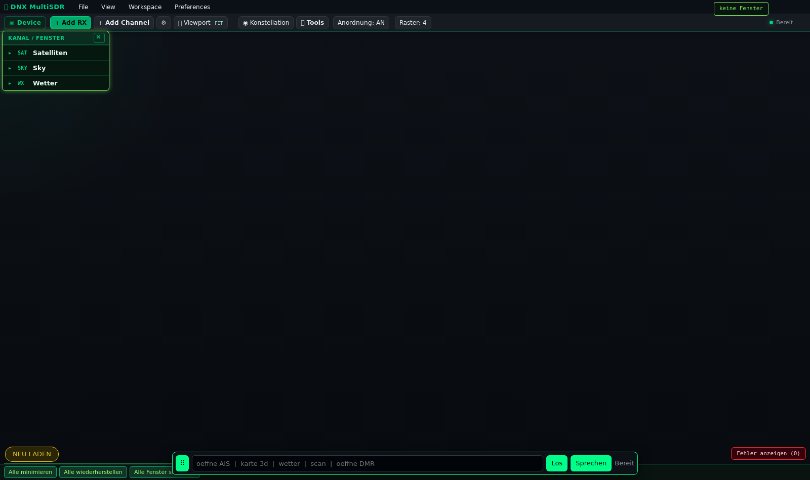

---

## SAT — Satelliten

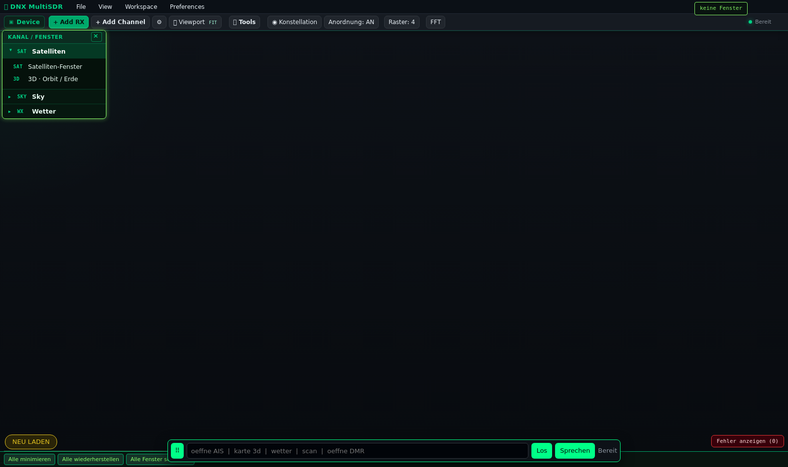

| Eintrag | Öffnet | Erklärung |
|---|---|---|
| **SAT · Satelliten-Fenster** | Live-Satelliten-Tracker | SDRangel-ähnlicher Tracker: Zielliste, Passagen-Diagramm (PASS-CHART), TLE-Daten, Antennenstellung |
| **3D · Orbit / Erde** | 3D-Orbit-Ansicht (Cesium) | Erde mit Tag/Nacht-Beleuchtung und Satellitenbahnen (NOAA 15/18/19, METEOR M2, ISS …) |

**Screenshots**

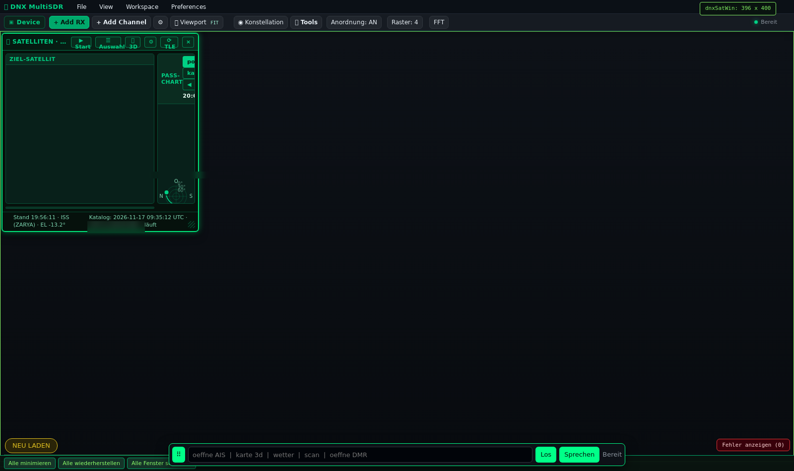

*Das Satelliten-Fenster zeigt u. a. `Stand … · ISS (ZARYA) · EL …°`, den aktuellen Katalog-Zeitstempel und den Elevationswinkel. Unten links wird die Passage des ausgewählten Satelliten angezeigt; oben befinden sich `Start`, `Auswahl`, `3D`, `TLE` und Aktualisieren.*

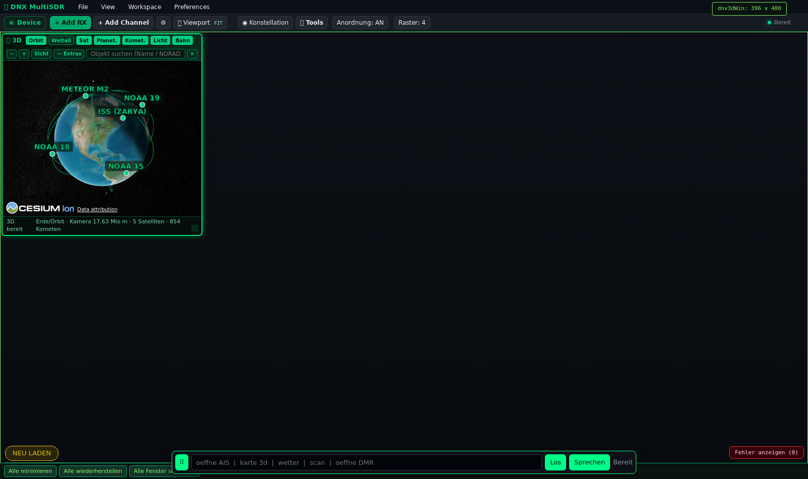

*Cesium-basierte 3D-Ansicht: `Orbit · Weltkarte · Sat · Planet · Komet · Licht · Bahn` sowie `Sicht · Extras · Objekt suchen (Name / NORAD)`. Unten blendet es `3D  Erde/Orbit · Kamera 17.63 Mio m · 5 Satelliten · 854 bereit Kometen` ein.*

> **Abhängigkeiten:** Für plausible Bahndaten/TLE braucht es Internetzugriff und einen
> funktionierenden Zeitabgleich — siehe [faq.md](faq.md).

---

## SKY — Sky / Weltall

| Eintrag | Öffnet | Erklärung |
|---|---|---|
| **SKY · Sky-Fenster** | Himmelsansicht | Himmelskörper mit Az/EL über dem Standort, Objektliste mit Positionen |
| **3D · Weltall** | 3D-Weltall-Ansicht (Cesium) | Deep-Sky: Sonnensystem, Kometen, Asteroiden mit Objektsuche |
| **POL · Polar · Arktis + Antarktis** | Polar-Doppelkarte | NASA-GIBS/Blue-Marble-Karten beider Pole (Gradnetz, Ebenen, Zoom) |

**Screenshots**

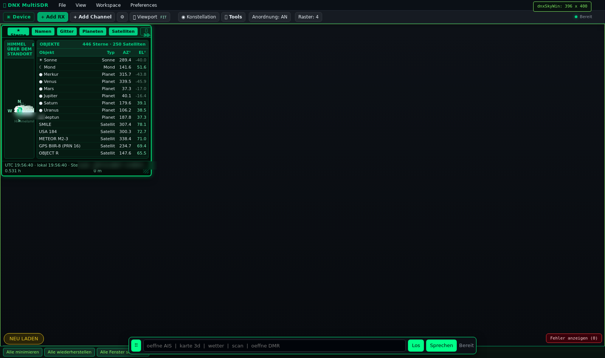

*Sky-Fenster: `Namen · Gitter · Planeten · Satelliten` sowie die Objektliste mit Az/EL (Sonne 289.4/−40.0, Mond 141.6/51.6, Merkur …). Oben Mitte `446 Sterne · 250 Satelliten`, links die Kompass-Himmelsansicht über dem Standort.*

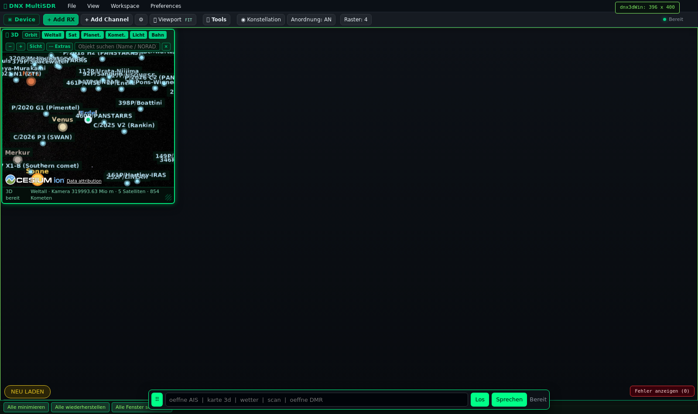

*3D-Weltall mit Objektsuche `Objekt suchen (Name / NORAD)`; sichtbar u. a. Venus, Merkur, Sonne, C/2025 V2 (Rankin), 398P/Boattini, 3I/ATLAS-ähnliche Kleinplanetoiden und Apollo-Gruppen. Unten: `3D  Weltall · Kamera 319993.63 Mio m · 5 Satelliten · 854 bereit Kometen`.*

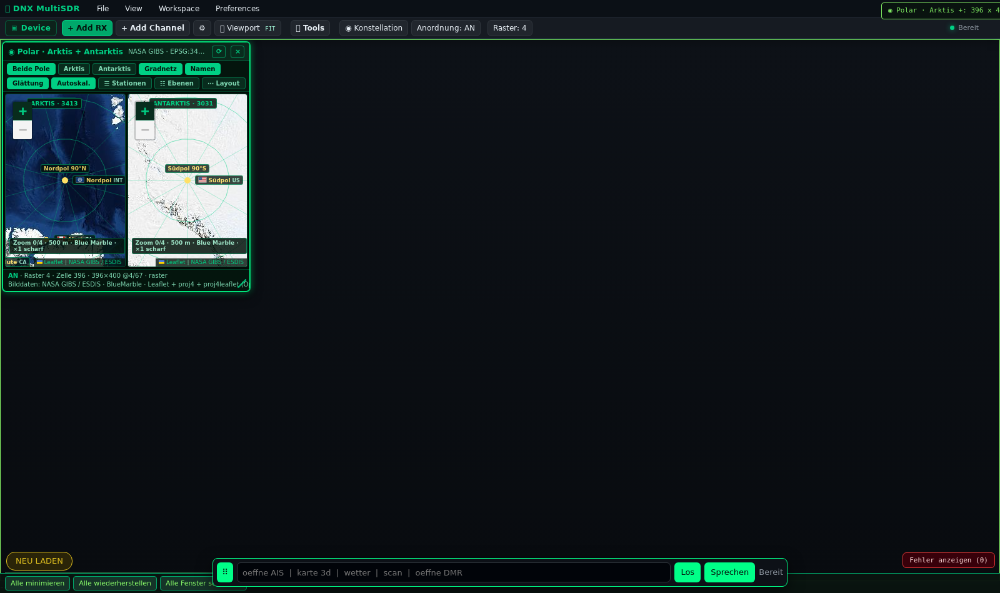

*Doppelfenster Polar: `Beide Pole · Arktis · Antarktis · Gradnetz · Namen · Glättung · Autoskal. · Stationen · Ebenen · Layout`; Bilddaten NASA GIBS / ESDIS – Blue Marble, Leaflet + proj4/proj4leaflet.*

---

## WX — Wetter (Wetterzentrale)

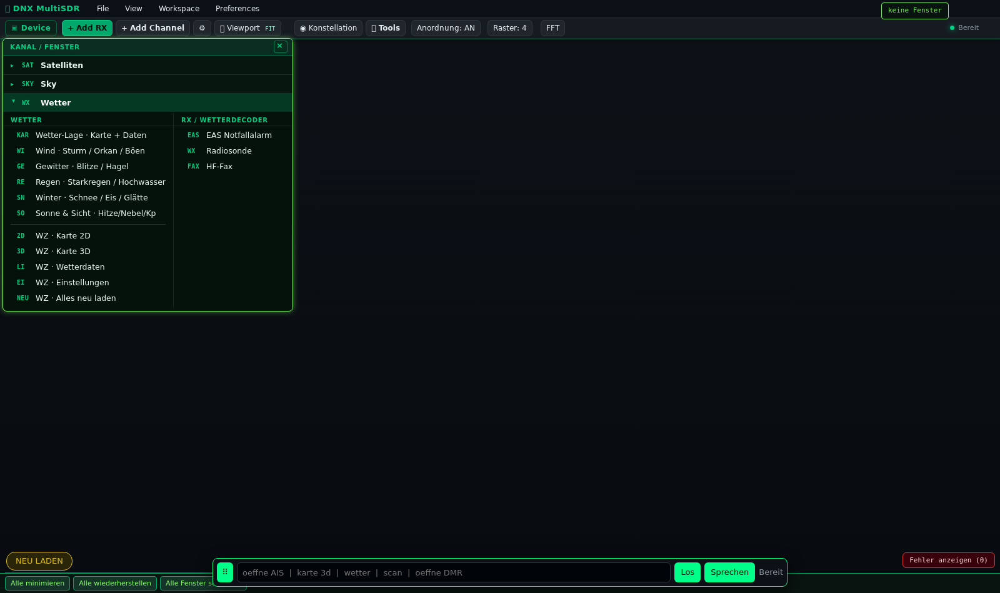

Die Wetter-Kategorie ist der größte Block in Add Channel. Er gliedert sich in
**phänomenspezifische Warn-Fenster**, **Karten** und **Datenzugriff**:

### Phänomenfenster (DWD-Warnungen + Bright Sky / DWD-Messwerte)

| Eintrag | Fenster | Inhalt |
|---|---|---|
| **KAR · Wetter-Lage · Karte + Daten** | Wetter-Lage | Blatt (Karte/Warnungen/Daten) mit DWD-Warnungen, Regenradar, Blitzen (DWD-Messwerte), Ebenen-Auswahl, Zeitleiste (`-2 … -7 min`) |
| **WI · Wind · Sturm / Orkan / Böen** | Wind | Warner (Sturm / Starkwind / Böenfront / Orkan / Tornado / Downburst) mit DWD-Warnstufen, Squelch-relevanter Richtwert `Wind-/Sturmböen ab 61 km/h` |
| **GE · Gewitter · Blitze / Hagel** | Gewitter | Gewitter / Blitze / Hagel / Downburst – Warnstufe `Gewitterwarnung Stufe 1+` ab … |
| **RE · Regen · Starkregen / Hochwasser** | Regen / Hochwasser | Starkregen / Dauerregen / Hochwasser – Richtwerte `ab 10 mm/1 h bzw. 20 mm/6 h` |
| **SN · Winter · Schnee / Eis / Glätte** | Winter | Schneefall / Eisregen / Glätte / Frost |
| **SO · Sonne & Sicht · Hitze/Nebel/Kp** | Sonne & Sicht | Hitze / Waldbrand / Nebel / Staub / Sand / Polarlichter (inkl. Kp-Index) |

**Screenshots**

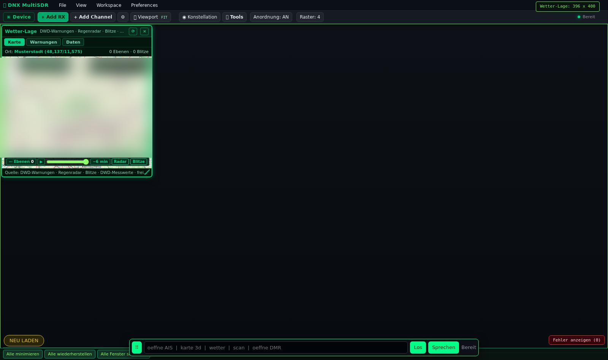

*Wetter-Lage (Blatt `Karte | Warnungen | Daten`): Leaflet-Karte mit DWD-Messwerten und Ebenen-Leiste; Statusleiste u. a. `Quelle: DWD-Warnungen · Regenradar · Blitze · DWD-Messwerte`.*

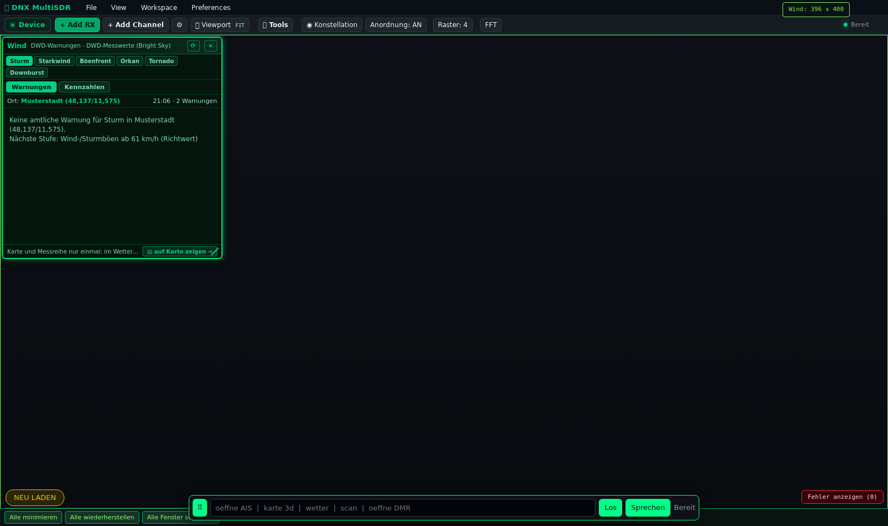 &nbsp; 

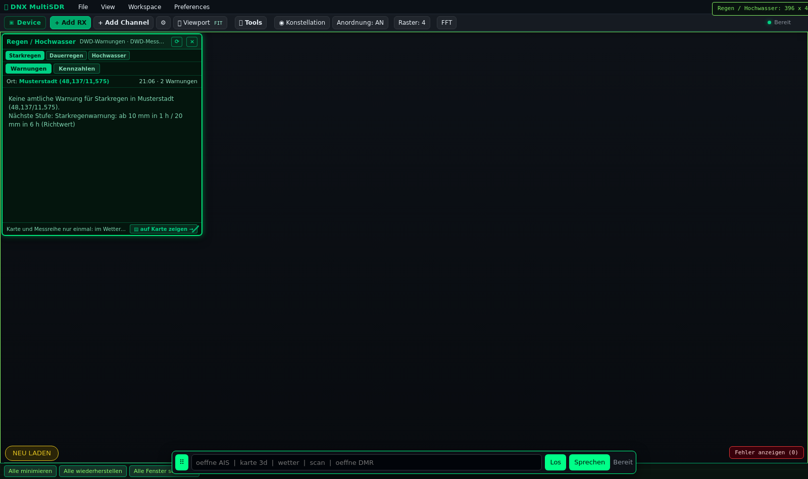 &nbsp; 

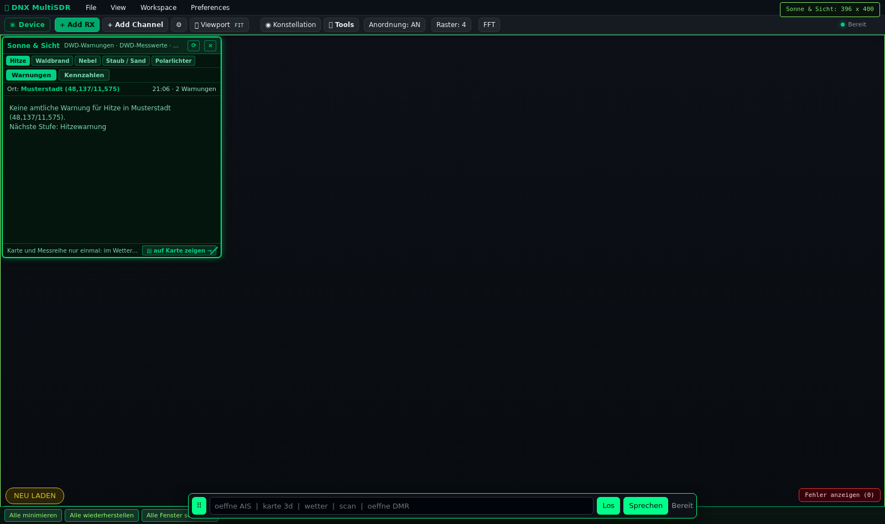

### Kennzahlen-Tab (DWD-Messwerte)

Jedes Phänomen-Fenster hat neben **Warnungen** einen zweiten Reiter **Kennzahlen** —
aktuelle DWD-Stationswerte statt amtlicher Warntexte. Hier die fünf Fenster umgeschaltet:

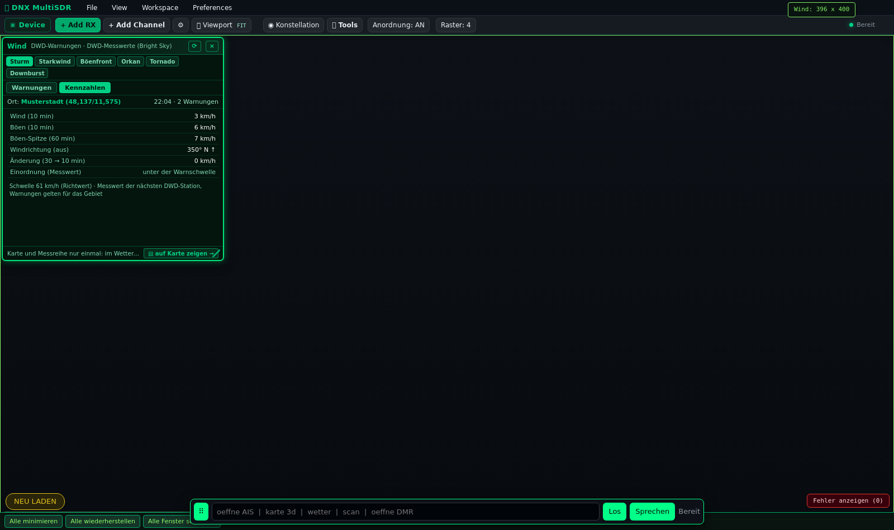

*Wind (Kennzahlen): `Wind 3 km/h · Böen 6 km/h · Böen-Spitze (60 min) 7 km/h ·
Windrichtung 350° N · Änderung 0 km/h · Einordnung (Messwert: unter der Warnschwelle)`,
Fußnote mit Richtwert (61 km/h) und Hinweis auf die nächste DWD-Station.*

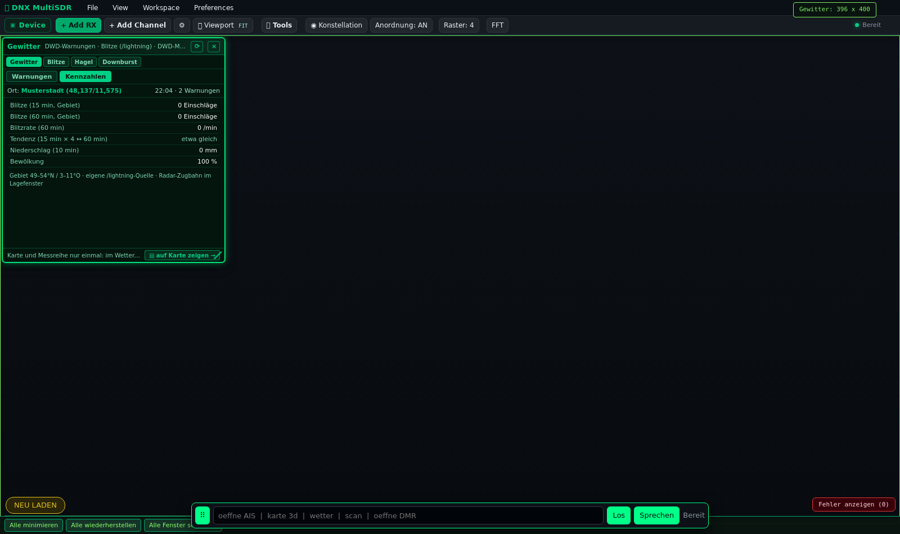

*Gewitter (Kennzahlen): `Blitze 15 min: 0 Einschläge · Blitze 60 min: 0 Einschläge ·
Blitzrate (60 min) 0/min · Tendenz etwa gleich · Niederschlag 0 mm · Bewölkung 100 %`;
Gebiets-Angabe `49–54°N / 3–11°O` mit eigener `/lightning`-Quelle · Radar-Zugbahn im
Lagefenster.*

*Regen / Hochwasser (Kennzahlen): `Niederschlag 10 / 60 min: 0 mm · Regenrate 0 mm/h ·
Summe 24 h 0 mm · Summe 72 h 10,7 mm · Zustand `fog`, DWD-Stundenwerte.*

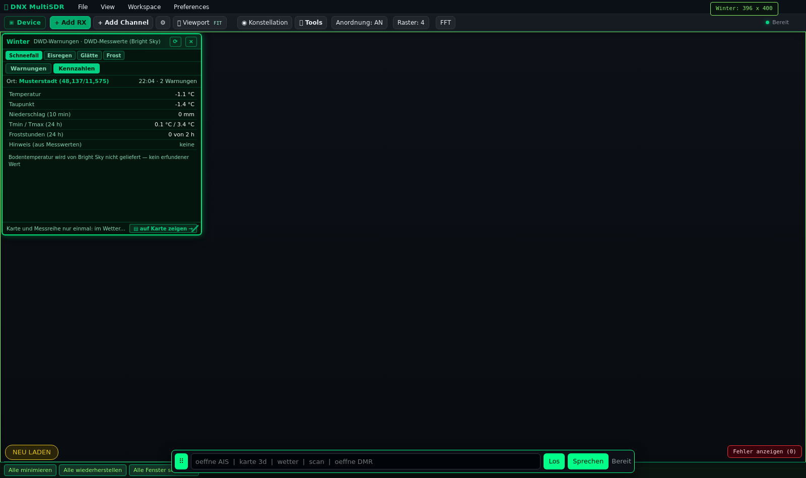

*Winter (Kennzahlen): `Temperatur −1,1 °C · Taupunkt −1,4 °C · Niederschlag 0 mm ·
Tmin/Tmax 0,1/3,4 °C · Froststunden (24 h) 0 von 2 h`; Fußnote:
`Bodentemperatur wird von Bright Sky nicht geliefert — kein erfundener Wert`.*

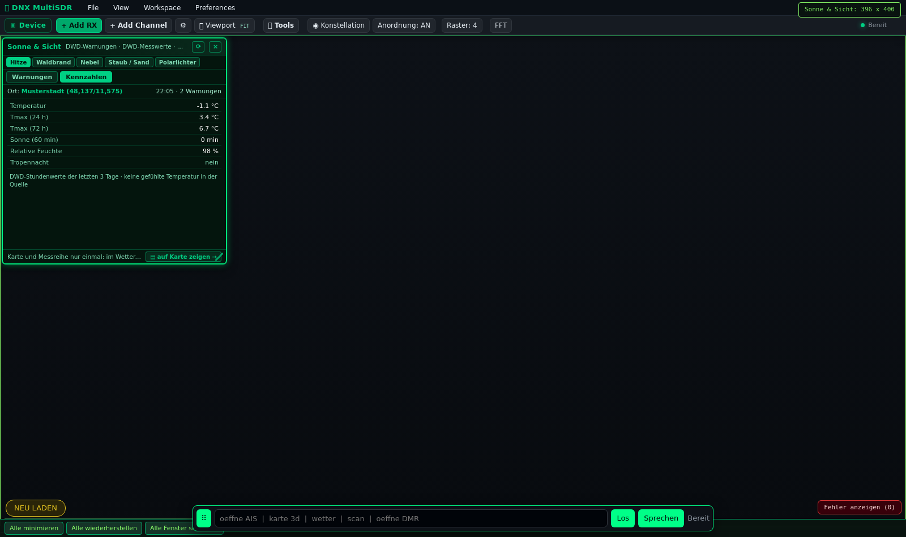

*Sonne & Sicht (Kennzahlen): `Temperatur −1,1 °C · Tmax (24 h) 3,4 °C · Tmax (72 h) 6,7 °C ·
Sonne (60 min) 0 min · Relative Feuchte 98 % · Tropennacht: nein`; DWD-Stundenwerte.*

### Karten (WZ – Wetterzentrale)

| Eintrag | Öffnet | Erklärung |
|---|---|---|
| **2D · WZ · Karte 2D** | 2D-Wetterkarte | Leaflet/OpenStreetMap-Karte mit Radar-, Blitz- (`Blitze`) und Wolken-Ebenen; Blitz-Zähler (hier `Blitz 347`), Zeitachse `-2…-7 min` |
| **3D · WZ · Karte 3D** | 3D-Wetterkarte | Cesium-basierte 3D-Globe-Ansicht (`Radar`, `Blitze`, `Wolken`, Terrain OpenStreetMap) – `3D bereit · gelbe Kreise = Blitze` |

**Screenshots**

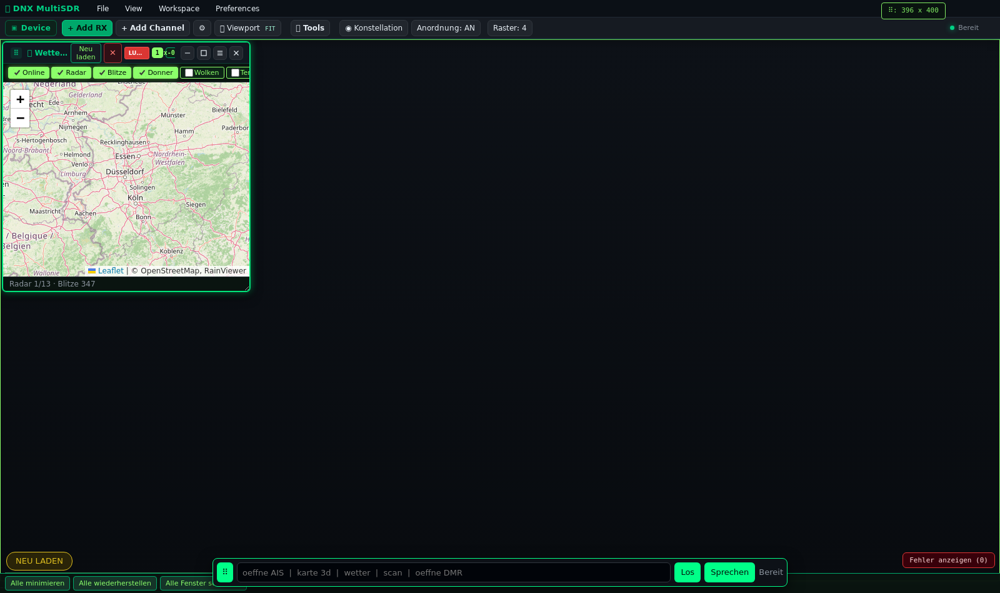

*2D: `Online ✓ Radar ✓ Blitze ✓ Donner □ Wolken …`; Statusleiste `Radar 1/13 · Blitze 347`; Attribution `© OpenStreetMap · RainViewer`.*

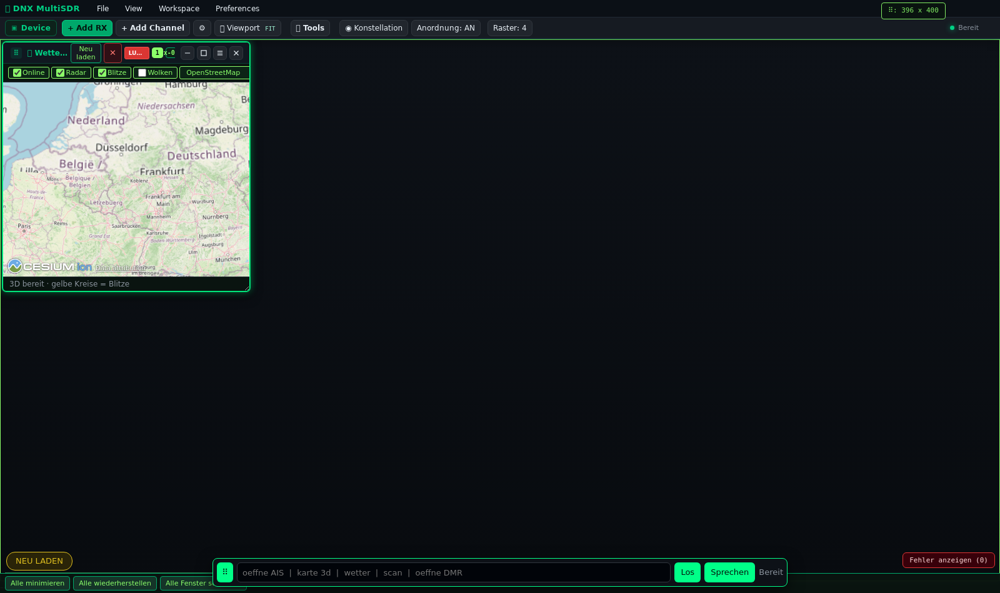

*3D: `Online ✓ Radar ✓ Blitze ✓ Wolken …`; Cesium-lon-Attribution; Statuszeile `3D bereit · gelbe Kreise = Blitze`.*

### Datenzugriff (WZ)

| Eintrag | Öffnet | Erklärung |
|---|---|---|
| **LI · WZ · Wetterdaten** | Wetterdaten-Tabelle | Liste (bis zu 500 Einträge, hier z. B. französische Blitzstandorte) mit `Zeit · Alter · Land · Ort · km · Lat · Lon`, sortierbar, `Aktualisieren`, CSV-Export |
| **EI · WZ · Einstellungen** | Wetter-Einstellungen | API-Schlüssel (OpenWeatherMap, Mapbox, Bing, ArcGIS, MapTiler, **Cesium Ion**, Google Maps, CheckWX), Radar-Deckkraft (65 %), `Radar hochauflösend (512er Kacheln)`, `Radar-Animation automatisch`, `Ort ermitteln: vom Server`, Ebenen (`Wolken`, `Wind`, `Temperatur`) |
| **NEU · WZ · Alles neu laden** | — | Lädt alle Wetterzentralen-Module/Datenquellen neu (harter Refresh nur der Wetter-Komponenten) |

**Screenshots**

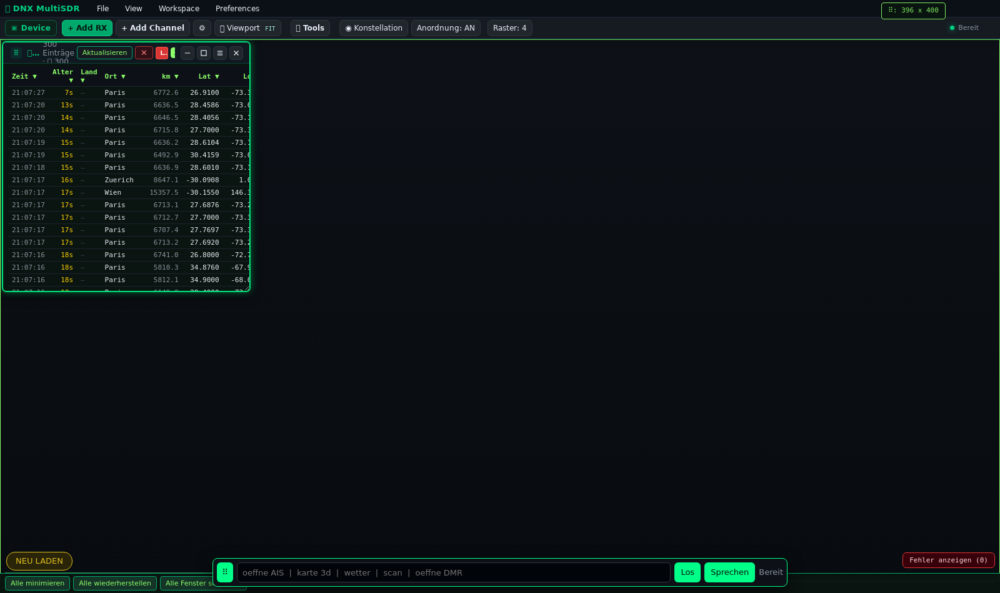

*Wetterdaten-Tabelle mit Live-Blitz-Ereignissen (Zeit, Alter in s, Land, Ort, Entfernung, Lat/Lon); `500 Einträge 21:3…`.*

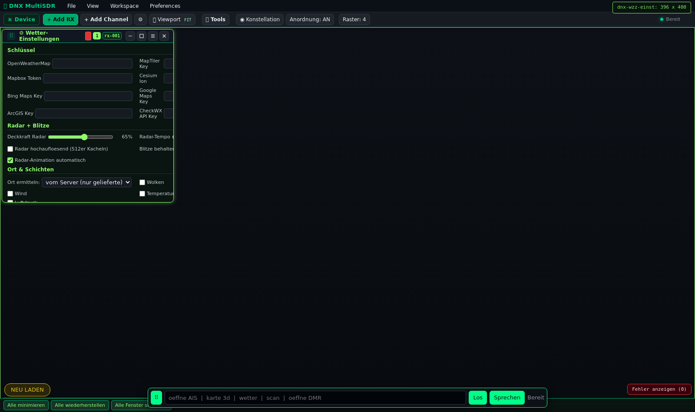

*Wetter-Einstellungen: Oben alle **API-Schlüssel** (in der öffentlichen Nutzung bewusst leer), darunter `Radar + Blitze`-Regler, Standort `vom Server (nur gelieferte…)` und Ebenen-Checkboxen (Wolken / Wind / Temperatur).*

> **Eigene API-Schlüssel:** Die Wetterzentrale ist ohne Schlüssel nur eingeschränkt
> benutzbar. Trage deine eigenen Schlüssel ein — keine Sorge, sie werden ausschließlich
> lokal in deinem Browser gespeichert und nicht geteilt.

---

## RX / WETTERDECODER

Dieser Bereich steht unterhalb der drei Kategorien (in derselben Palette) und bindet
**RX-abhängige Dekoder-Fenster** an:

| Eintrag | Öffnet | Erklärung |
|---|---|---|
| **EAS · EAS Notfallalarm** | EAS-Suite | EAS/Notfallalarm-Fenster mit START/STOP, Squelch, Bandbreite `10 kHz`, Mitschneide-Funktion, Frequenz-Tabelle und Monitor |
| **WX · Radiosonde** | Radiosonden-Decoder | RTTY/M20-Dekoder für Wettersonden (RS41, DFM, M10/M20, MTS01), 4 Presets (403–406 MHz), Telemetrie-Tabelle, Wasserfall, CSV-Export |
| **FAX · HF-Fax** | HF-Fax-Suite | HF-Wetterkarten-Empfang (DWD/BOM/NOAA/NWS), Faxbild-Canvas, Frequenzen-Tabelle, Ortszeit-Dialog |

Alle drei **öffnen bei fehlendem RX automatisch den Receiver-Dialog**; kombiniert mit
einem geöffneten RX (hier mit der hardwarefreien `DSP Test Source`) öffnen sich die Fenster:

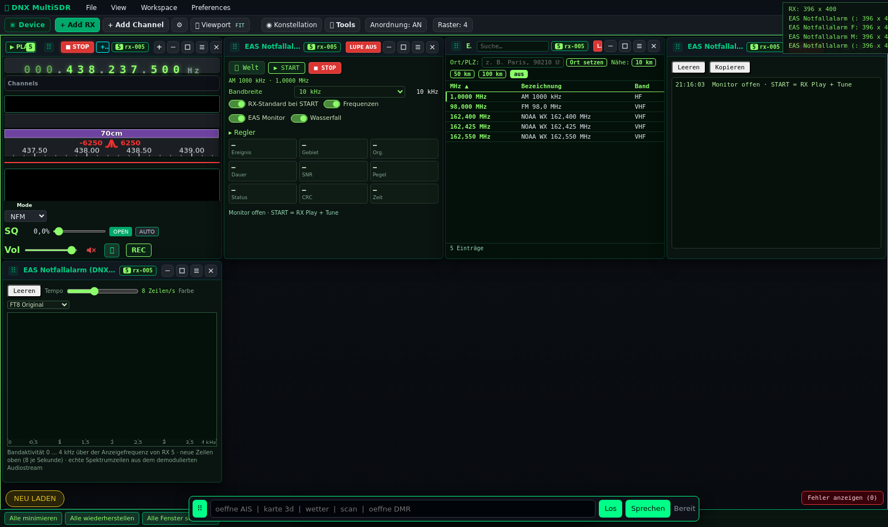

*EAS Notfallalarm: `Bandbreite 10 kHz`, `1,0000 MHz / 98,0 / 162,3 / 162,4 / 162,425 / 162,55` MHz (HF + NOAA WX VHF), Tabs `Warnungen | Kennzahlen`, Monitor (`21:16:03 Monitor offen · START = RX Play + Tune`), Frequenz-Panel (`5 Einträge`), Wasserfall mit `FT8 Original`-Modus und `8 Zeilen/Farbe`.*

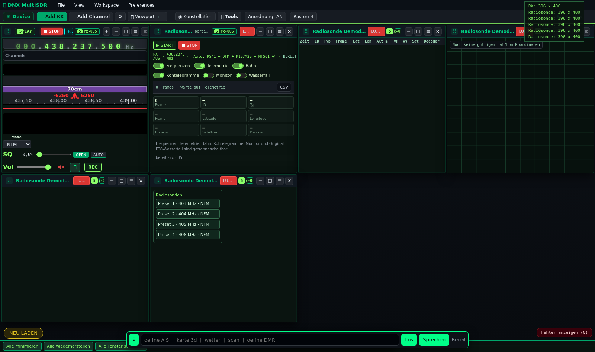

*Radiosonde: `Auto: RS41 + DFM + M10/M20 + MTS01`, Presets 1–4 (403/404/405/406 MHz NFM), Telemetry-Auswahl (Frequenzen · Telemetrie · Bahn · Rohtelegramme · Monitor · Wasserfall), `0 Frames · warte auf Telemetrie`, Tabellen-Ansicht (Zeit · ID · Typ · Frame · Lat · Lon · Alt · m · Sat · Decoder) mit `CSV`-Export.*

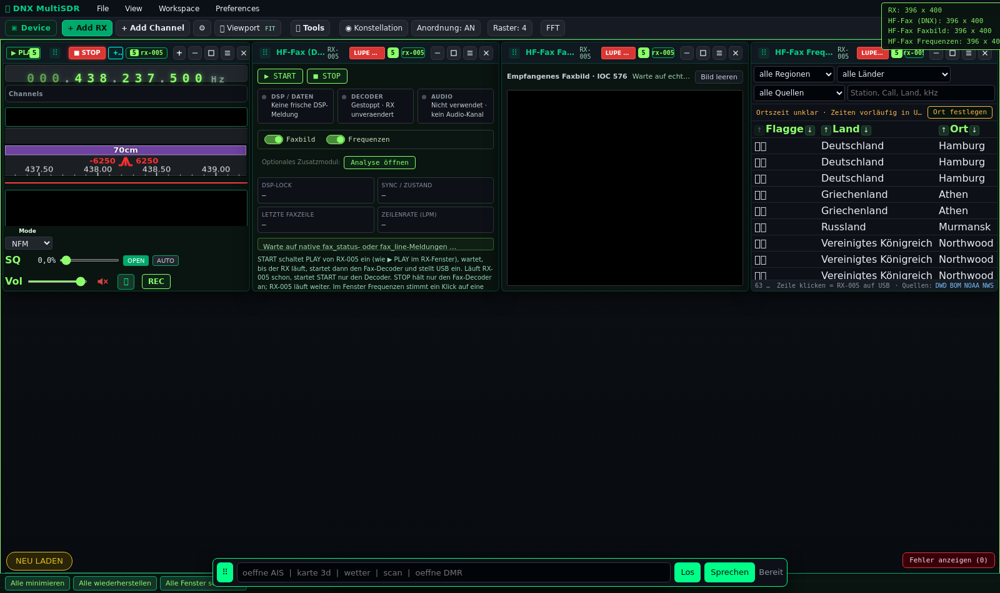

*HF-Fax (DNX): START/STOP, Status-Panel (`Warte auf native fax_status`, `DECODER Gestoppt`, `AUDIO Nicht verwendet`), Faxbild-Canvas (`Empfangenes Faxbild · IOC 576`), rechts die globale Stationsliste (`alle Regionen / alle Länder` ⇒ Deutschland Hamburg, Griechenland Athen, Russland Murmansk, UK Northwood; `63 Einträge · Quellen: DWD BOM NOAA NWS`), unten `Zeile klicken = RX-005 auf USB`.*

> **Zeit & Sendezeiten:** HF-Fax veröffentlicht Sendezeiten **in UTC**. DNX MultiSDR
> rechnet sie in die festgelegte Ortszeit um. Der Dialog `Ortszeit für die Sendezeiten`
> (unten) fragt beim ersten Mal, wie die lokale Zeit behandelt werden soll — UTC, MEZ/Berlin
> oder eine andere Ortsauswahl:
>
> 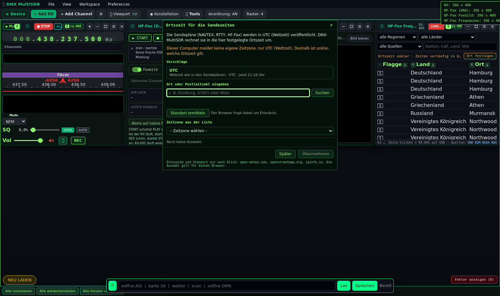
>
> Details und der Unterschied Fall/MEZ/UTC: [wetter.md](wetter.md#hf-fax--sendezeiten--utc-vs-mez).
>
> **HF-Fax & Rechtsrahmen:** Der Empfang reiner Wetterkarten ist unkritisch, der
> Empfang von Vollzugriffsinhalten (NAVTEX etc.) kann Beschränkungen unterliegen —
> siehe [disclaimer.md](disclaimer.md).
