# Bedienelemente im Detail — Fenster, Leisten, Dialoge

Diese Seite beschreibt die **Bedienelemente abseits der Menüs**: Fenster-Titelleisten,
das `≡`-Fenstermenü, das Preferences-Menü im Detail, die Geräte-Einstellungen, die
untere Statuszeile, die Befehlsleiste mit `Los` — und wo genau ein Decoder-RX
**gestartet** wird. Alle Screenshots zeigen den hardwarefreien **DSP Test Source**-RX
(synthetisches Signal), Kartenausschnitte sind unscharf gehalten. Kein Knopf wurde
gedrückt, der einen Live-Empfang oder Dekodierstart auslöst (Details:
[disclaimer.md](disclaimer.md)).

---

## 1. Titelleiste jedes Fensters

Jedes Fenster (RX, FFT, Decoder, Karten …) trägt oben rechts denselben Satz Knöpfe:

| Element | Funktion |
|---|---|
| `⠿` (links im Kopf) | **Ziehen** — Fenster verschieben (bei `Anordnung: AN` später wieder einsortiert) |
| Grüne Nummer-Plakette (`4`) | RX-Nummer des Fensters (`rx-004` steht rechts daneben) |
| `LUPE AUS` | Decoder-Kanalmonitor (Lupe) an-/ausschalten |
| `–` (Minimieren) | Fenster einklappen/minimieren |
| `□` (Maximieren/Wiederherstellen) | Fenster auf volle Größe / zurück |
| `≡` (Menü) | **Fenstermenü** (Details: §3) |
| `✕` (Schließen) | Fenster schließen (nur die Ansicht, der RX bleibt registriert) |

---

## 2. Raster 2–6 und Anordnung AN/AUS

Zwei Toolbar-Schalter steuern, **wo** Fenster landen:

- **`Raster: n`** — Klick zyklisch `4 → 5 → 6 → 2 → 3 → …` (Wrap-Around). Die Zahl gibt
  die Spaltenzahl des automatischen Fensterrasters an; Fenster sind standardmäßig
  `396 × 400 px` — `Raster: 2`/`3` macht die Fenster breiter, `5`/`6` schmaler.
- **`Anordnung: AN`** — der Layout-Packer ordnet Fenster automatisch (und bei jedem
  neuen Fenster) neu im Raster an.
- **`Anordnung: AUS`** — der Packer hält sich zurück; Fenster sind frei verschiebbar
  (`AUS = frei ziehen + Resize`, laut Tooltip). Praktisch: Fenster einmal sinnvoll
  anordnen und so lassen.

### Raster-Beispiele (jeweils 7 Fenster: RX + FFT + CW-Decoder)

| Raster | Screenshot |
|---|---|
| `Raster: 4` |  |
| `Raster: 2` | 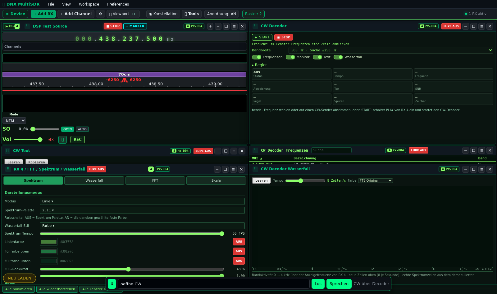 |
| `Raster: 3` | 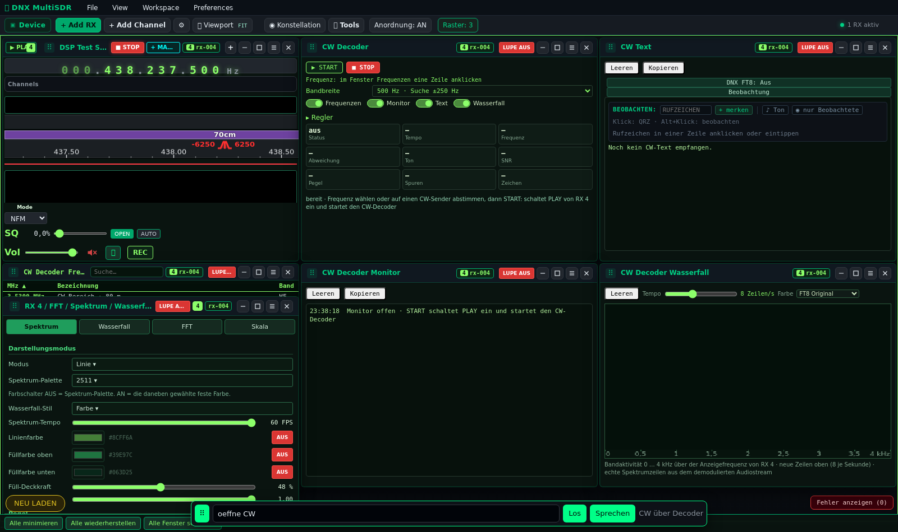 |
| `Raster: 5` | 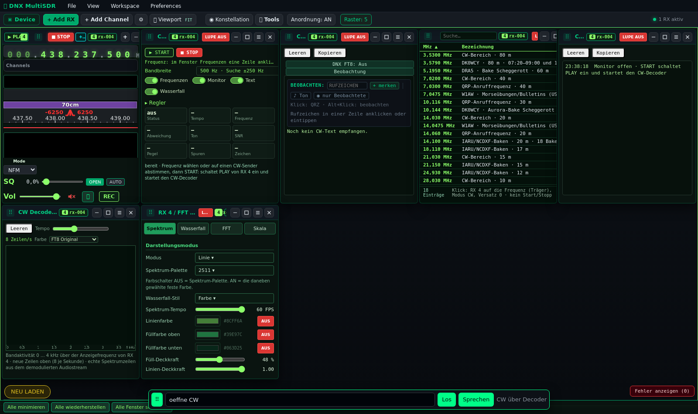 |
| `Raster: 6` | 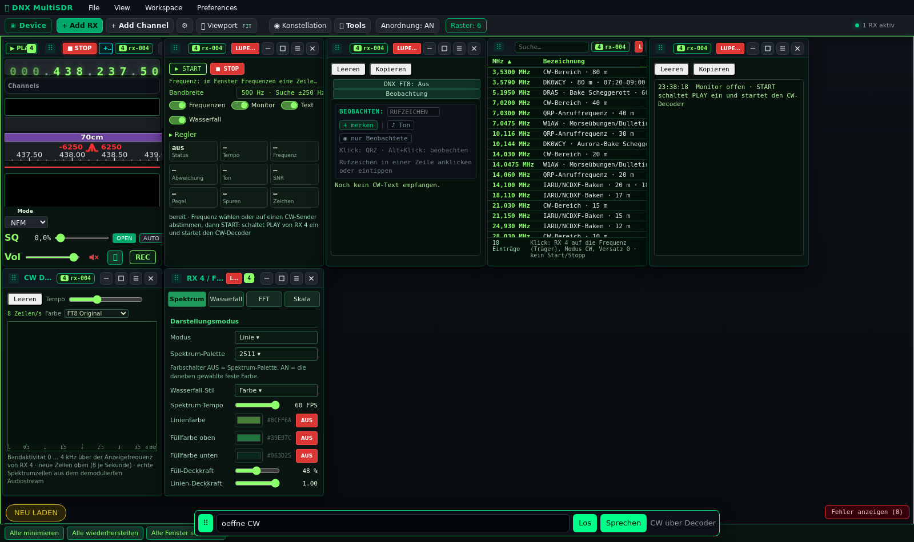 |

### Anordnung AUS — Beispiel

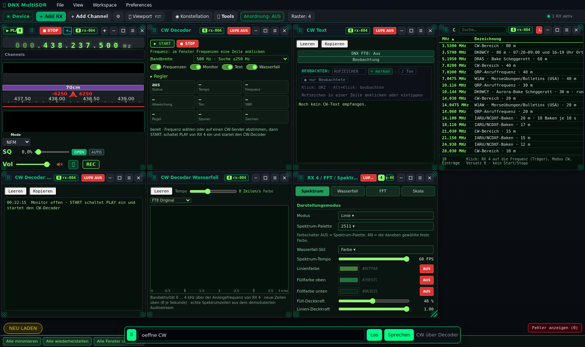

*Toolbar zeigt `Anordnung: AUS` (grün); der Packer greift nicht mehr ein — Fenster
behalten ihre freie Position, bis du sie selbst bewegst.*

**`🖥 Viewport FIT`** passt die Ansicht passend zum Fenster-Inhalt an
(). **`⟲ Reset`** setzt die RX-Parameter
(Gain, AGC, Empfangspegel) auf Standard zurück. `⚙ Device Defaults` öffnet **nicht**
die Vorgaben, sondern den Auswahldialog *Receiver hinzufügen* (siehe §5/§6) —
beobachtetes Verhalten der Beta.

---

## 3. Das `≡`-Menü in der Titelleiste

Der `≡`-Knopf in **jedem** Fensterkopf öffnet ein Kontextmenü mit denselben
Basis-Einträgen (hier am **FFT-Fenster**):

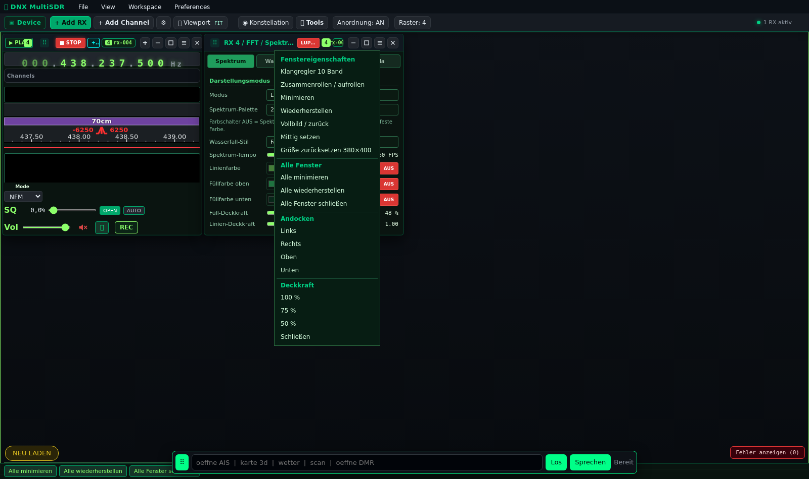

**Basis-Einträge (alle Fenster):**

- **Fenstereigenschaften** (Überschrift)
- `Klangregler 10 Band` — öffnet denselben 10-Band-Equalizer wie Preferences →
  *Audio-Equalizer aktiver RX* (siehe §4/§8)
- `Zusammenrollen / aufrollen` — Inhalt ein-/ausklappen
- `Minimieren` / `Wiederherstellen` — wie die `–`/`□`-Knöpfe
- `Vollbild / zurück` — Fenster maximieren/zurück
- `Mittig setzen` — Fenster zentrieren
- `Größe zurücksetzen 380×400`
- **Alle Fenster** — `Alle minimieren` / `Alle wiederherstellen` / `Alle Fenster schließen`
- **Andocken** — `Links` / `Rechts` / `Oben` / `Unten`
- **Deckkraft** — `100 %` / `75 %` / `50 %` / `Schließen`

Das **RX-Fenster** hat zwei zusätzliche Einträge ganz oben:

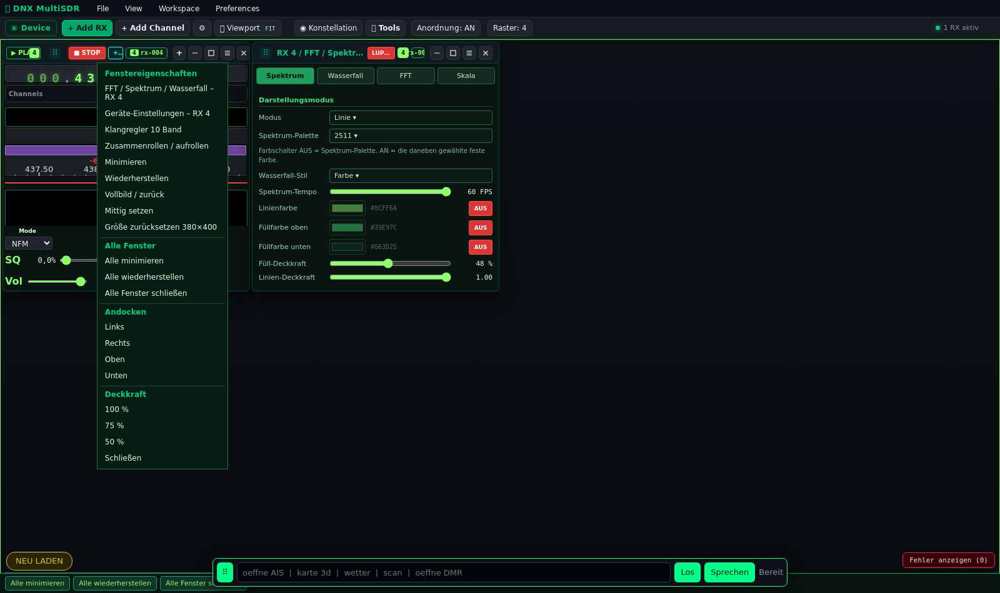

- **`FFT / Spektrum / Wasserfall – RX <n>`** — schaltet das FFT-Fenster dieses RX ein/aus
- **`Geräte-Einstellungen – RX <n>`** — öffnet die **Device Einstellungen** dieses RX
  (siehe §5) — das ist der eigentliche Einstellungs-Dialog pro Empfänger

---

## 4. Preferences-Menü im Detail

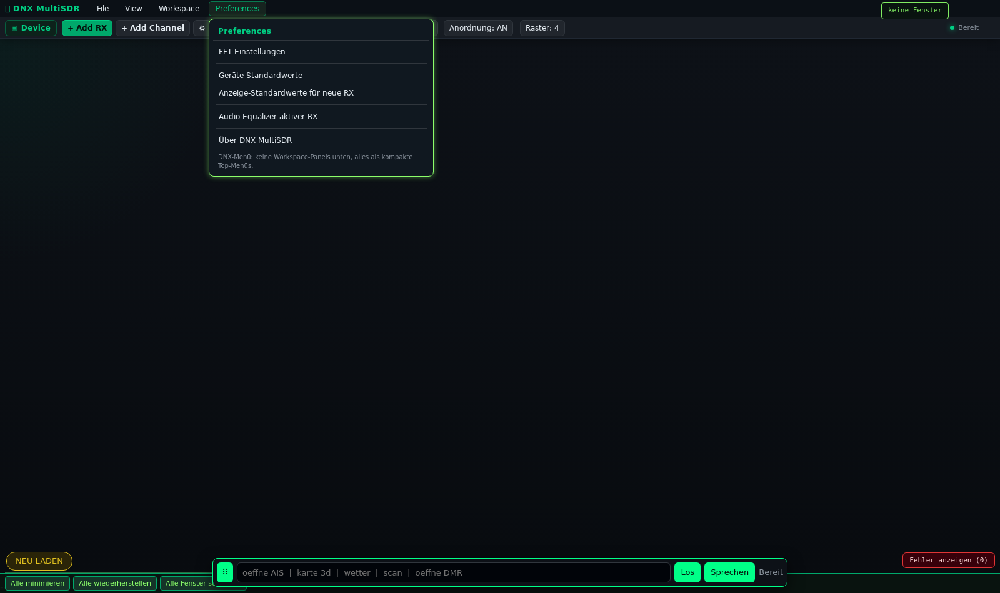

| Eintrag | Was passiert (beobachtet, Beta v0.9.0) |
|---|---|
| `FFT Einstellungen` | **öffnet/aktualisiert das FFT-Fenster** des aktiven RX — **kein** Einstellungs-Dialog (die FFT-Parameter sitzen im FFT-Fenster selbst, siehe §9). Ohne aktiven RX passiert nichts. |
| `Geräte-Standardwerte` | Keine sichtbare Wirkung in dieser Beta |
| `Anzeige-Standardwerte für neue RX` | Keine sichtbare Wirkung in dieser Beta (rote Menüfarbe signalisiert: gefährlich/experimentell) |
| `Audio-Equalizer aktiver RX` | Öffnet den 10-Band-Equalizer des aktiven RX (siehe §8) |
| `Über DNX MultiSDR` | Versions-/Komponentenliste |

Der Fuß-Hinweis im Menü: *„DNX-Menü: keine Workspace-Panels unten, alles als kompakte
Top-Menüs.“*

### FFT-Fenster über `Preferences → FFT Einstellungen` geöffnet

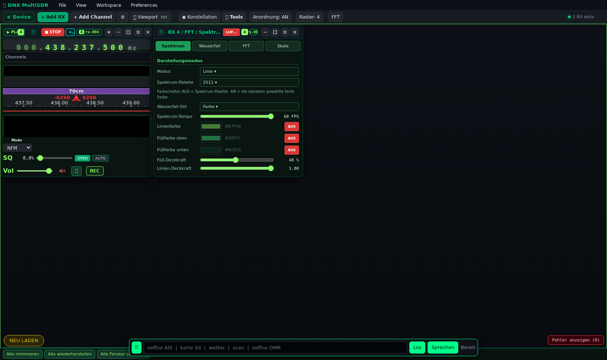

---

## 5. Geräte-Einstellungen (Device Einstellungen) im Detail

**Zugang:** RX-Fenster anklicken → `≡` in der Titelleiste → **`Geräte-Einstellungen – RX <n>`**.

Das Fenster `RX <n> / Device Einstellungen` enthält die hardwarenahe Konfiguration
**pro RX** (kleine Fensteransicht und maximiert):

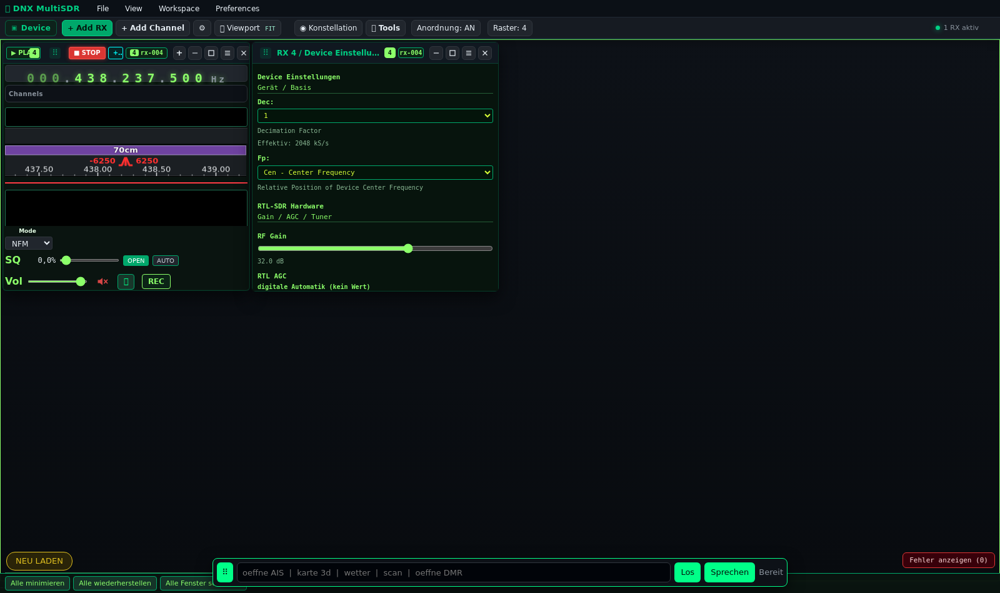
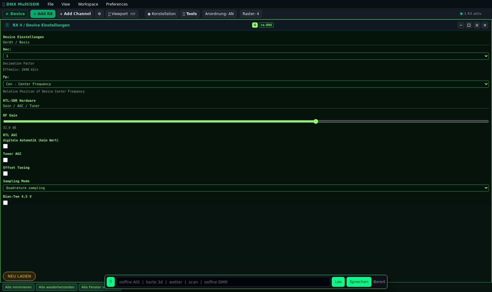

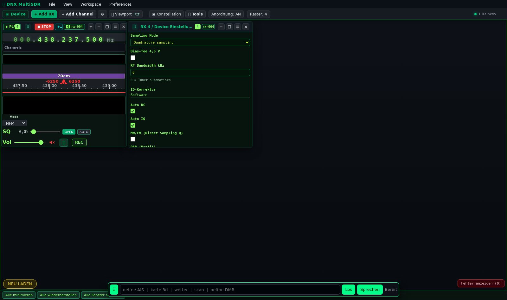
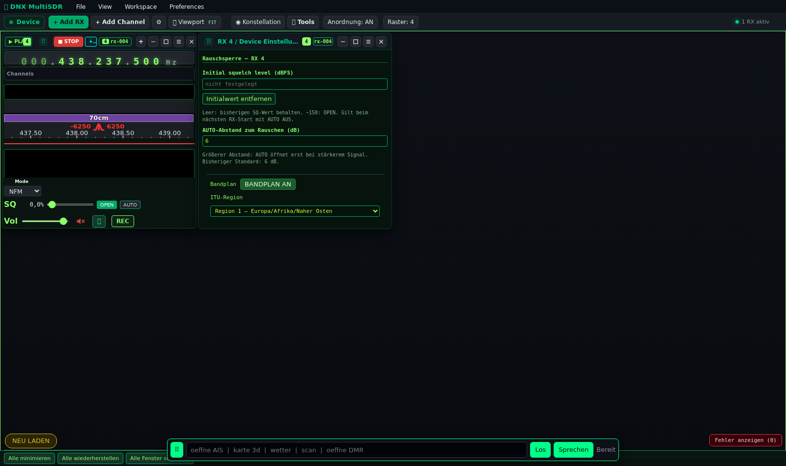

**Inhalt (von oben nach unten):**

| Abschnitt | Elemente |
|---|---|
| **Gerät / Basis** | `Dec` — Decimation Factor `1 / 2 / 4 / 8 / 16 / 32 / 64` (effektiv z. B. `2048 kS/s`); `Fp` — `Cen – Center Frequency` / `Sub – Relative Position` / `Inf – Relative Position of Device Center Frequency` |
| **RTL-SDR Hardware / Gain · AGC · Tuner** | `RF Gain` (Slider, hier `32,0 dB`); `RTL AGC` (digitale Automatik, kein Wert); `Tuner AGC`; `Offset Tuning` |
| **Sampling Mode** | `Quadrature sampling`, `Direct sampling (I branch)`, `Direct sampling (Q branch)` |
| **Bias-Tee 4,5 V** | Schalter für die Bias-Spannung am Tuner-Ausgang |
| **RF Bandwidth kHz** | `0` = Tuner automatisch |
| **IQ-Korrektur / Software** | `Auto DC`, `Auto IQ` (beides hier aktiv) |
| **MW / FM (Direct Sampling Q)** | Direkt-Sampling-Profil für Mittelwelle/UKW |
| **DAB (Profil)** | DAB+-Profil-Schalter |
| **LO ppm** | Korrektur der Quarz-Abweichung |
| **Samplerate** | RTL-SDR-Geräte-IQ-Rate; gültige Bereiche `225,001–300` und `900,001–3200 kS/s` (hier `2,048 MS/s`) |
| **IF Frequency** | `0 kHz` / `450 kHz` / `1620 kHz` / `2048 kHz` |
| **Rauschsperre – RX <n>** | *Initial squelch level (dBFS)* (`nicht festgelegt`, `Initialwert entfernen` — beim nächsten RX-Start mit `AUTO AUS` gültig); *AUTO-Abstand zum Rauschen (dB)* — größerer Abstand, AUTO öffnet erst bei stärkerem Signal (bisheriger Standard: `6 dB`) |
| **Bandplan** | `BANDPLAN AN` + `ITU-Region` — `Region 1` (Europa/Afrika/Naher Osten), `Region 2` (Amerika), `Region 3` (Südasien/Pazifik) |

Die Einstellungen werden **pro RX** lokal gespeichert (interner Schlüssel
`dnx-devset-rx-<rx>`); FFT-/Spektrum-Parameter sind **nicht** hier, sondern im
FFT-Fenster.

### `⚙ Device Defaults` (Toolbar) — was es in dieser Beta wirklich tut

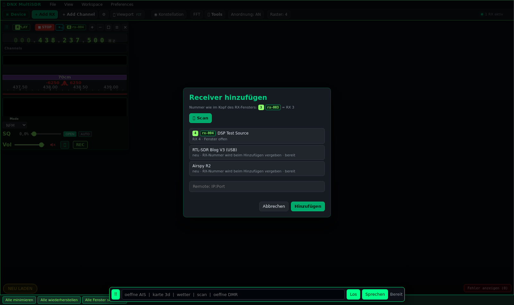

Der Toolbar-Knopf **`⚙ Device Defaults`** (Titel: *Device-/Anzeige-Defaults für neue
RX*) öffnet in dieser Beta den Dialog **„Receiver hinzufügen“** — dieselbe Liste wie
`+ Add RX` (vorhandene RX als „Fenster offen“ markiert, SDR-Geräte als „neu ·
RX-Nummer wird beim Hinzufügen vergeben · bereit“, dazu `Remote: IP:Port` und `Scan`).
Echte *Vorgaben* für neue RX (Gain/AGC/Samplerate) erreichst du über
`≡ → Geräte-Einstellungen – RX <n>`.

Der grüne **`Device`**-Knopf links daneben (Titel *Add RX Device Einstellungen*) ist
als obsolet markiert und hier nur zur Vollständigkeit dokumentiert.

---

## 6. Add RX im Detail — und wo der EQ steckt

`+ Add RX` öffnet **Receiver hinzufügen**:

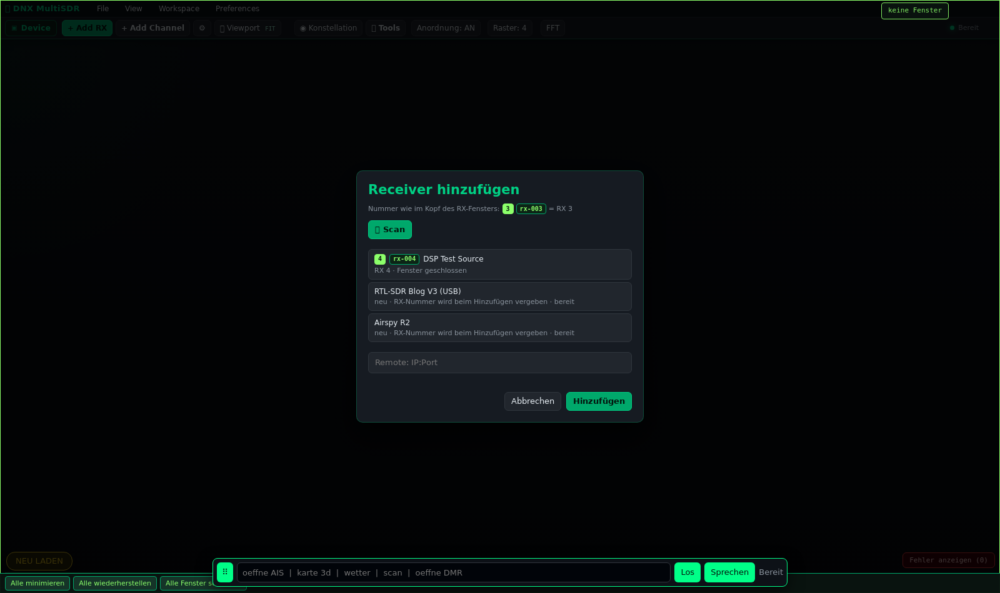

- **Scan** — angeschlossene SDR-Geräte neu suchen
- **Liste** — `DSP Test Source` (synthetisch, hardwarefrei), `RTL-SDR Blog V3 (USB)`,
  `Airspy R2` (*neu*), `Remote: IP:Port`; unter jedem Eintrag steht `RX <n> · Fenster
  offen/geschlossen` bzw. „RX-Nummer wird beim Hinzufügen vergeben · bereit“
- Rechts oben die **nächste freie Nummer** (`3 · rx-003`) wie im Kopf des RX-Fensters
- `Hinzufügen` übernimmt die Auswahl und öffnet das RX-Fenster; `Abbrechen` schließt
  den Dialog

**Der Equalizer ist nicht Teil dieses Dialogs.** Du erreichst ihn nach dem Hinzufügen auf drei Wegen (alle identisch):

1. Preferences → `Audio-Equalizer aktiver RX`
2. `≡` in der Titelleiste des RX-Fensters → `Klangregler 10 Band`
3. Der `🎶`-Knopf direkt in der Titelleiste des RX-Fensters

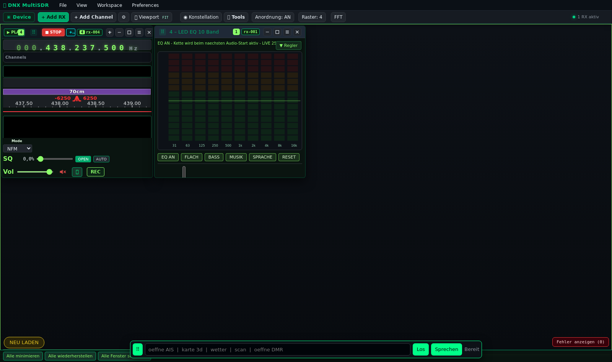

Das EQ-Fenster (`<n> – LED EQ 10 Band`) zeigt: zehn Bänder `31 Hz … 16 kHz` mit
Segment-Anzeige, **`EQ AN`**, **`Preamp`** (-12 … +12 dB, `Ziehen = Pegel · Doppelklick =
Band auf 0`), Presets **`FLACH`**, **`BASS`**, **`MUSIK`**, **`SPRACHE`**, `RESET`,
LIVE-Latenz (`LIVE 17,0 ms ▼ Regler`) und den Hinweis, dass die Kette beim nächsten
Audio-Start aktiv wird. „Einstellungen gespeichert“ bestätigt Änderungen.

---

## 7. Die Befehlsleiste — `oeffne AIS` & Co., dann `Los`

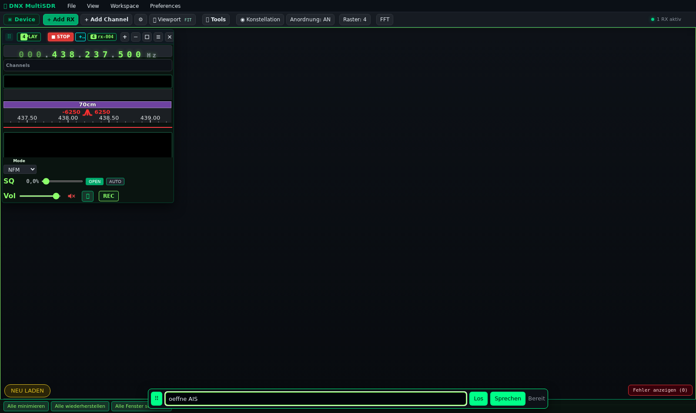

Die Leiste unten mittig ist eine Kommandozeile; der Platzhalter zeigt die Syntax:
`oeffne AIS | karte 3d | wetter | scan | oeffne DMR`.

| Element | Bedeutung |
|---|---|
| Textfeld | Befehl eintippen, z. B. `oeffne AIS` |
| `Los` | führt den eingetippten Befehl aus |
| `Sprechen` | Spracheingabe (Speech-to-Text → Befehl) |
| `Bereit` | Voice-Standby-Status des Assistenten |

**Beispiel-Flow:** `oeffne AIS` eintippen → **`Los` klicken** → 2 neue Fenster:

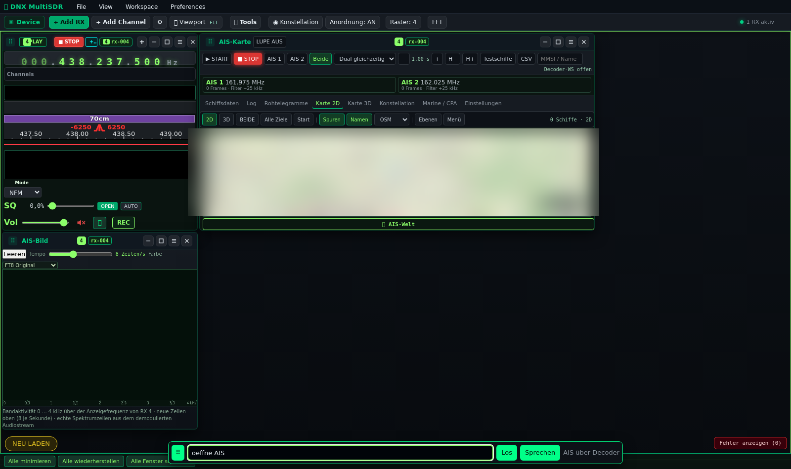

- **AIS-Karte** — Steuerung + Karte (Frequenzen 161,975 / 162,025 MHz, `AIS 1/2/Beide`,
  Dual gleichzeitig, Testschiffe, CSV-Export …). *Die Kartenansicht ist in diesem
  Screenshot unscharf — Kartenkacheln (OpenStreetMap) können Standort-Information
  preisgeben.*
- **AIS-Bild** — Wasserfall (`FT8 Original`, 8 Zeilen/s)

Analoges Beispiel `oeffne CW` (siehe [decoder.md](decoder.md) — jedes Dekoder-Fenster
mit Screenshot).

> **Hinweis:** Befehle **öffnen nur Fenster** — sie starten weder Empfang noch Dekodierung.
> Der eigentliche Start läuft im jeweiligen Dekoder-Fenster über **START** (§8).

---

## 8. Decoder-RX **starten** — wie, wann, wo

**Wo:** Im jeweiligen **Dekoder-Fenster**, oben links — nicht in der Toolbar.

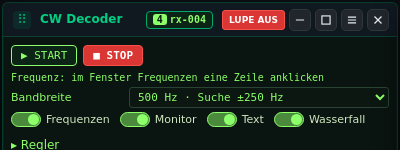

**Wie:** Jeder Decoder hat `▶ START` (grün) und `■ STOP` (rot) in der Kopfzeile:

1. **Frequenz wählen** — z. B. im CW-Decoder eine Zeile der Frequenzliste anklicken
   oder abstimmen (der On-Screen-Hinweis im Fenster lautet: *„Frequenz wählen oder auf
   einen CW-Sender abstimmen, dann START: schaltet PLAY von RX <n> ein und startet den
   CW-Decoder“* — wörtlich aus dem UI)
2. **Betriebsart/Bandbreite/Parameter** setzen (Mode `CW`, Bandbreite, Decoder-Toggles …)
3. **`START` drücken** — schaltet `PLAY` des zugehörigen RX ein und startet den
   Decoder; `STOP` hält an

Dasselbe Muster bei AIS (Bild oben: `START`/`STOP` neben `AIS 1/2/Beide`), DMR, APRS,
CW, DAB, TETRA, … — siehe [decoder.md](decoder.md) mit allen Fenstern.

**Wann:** Erst, wenn du tatsächlich dekodieren/abhören willst. Fenster öffnen, Befehle
eintippen und `Los` klicken starten **keinen** Empfang; es ist kein Live-Start nötig
und in dieser Doku auch keiner ausgeführt. Ohne gesetzte Frequenz ist START wirkungslos
bzw. zeigt den Hinweis. `Decoder-RX starten` = START drücken **nach** Frequenzwahl —
„die Frequency zuerst, dann START“ ist die Reihenfolge.

**STOP** beendet nur den Decoder; der RX bleibt registriert (Fenster schließen ≠
Empfänger entfernen).

---

## 9. Das FFT-Fenster im Detail

Über `Preferences → FFT Einstellungen`, den Toolbar-Knopf **`FFT`** oder
`≡ → FFT / Spektrum / Wasserfall – RX <n>`:

Vier Reiter: **`Spektrum`** · **`Wasserfall`** · **`FFT`** · **`Skala`**.
Im `Spektrum`-Reiter unter *Darstellungsmodus*:

- `Modus` — z. B. `Linie`
- `Spektrum-Palette` — z. B. `2511` (Farbverlauf); „Farbschalter AUS = Spektrum-Palette,
  AN = die daneben gewählte feste Farbe“
- `Wasserfall-Stil` — z. B. `Farbe`
- `Spektrum-Tempo` — hier `60 FPS`
- `Linienfarbe` `#8CFF6A`, `Füllfarbe oben` `#39E97C`, `Füllfarbe unten` `#063D25`
  (mit je einem `AUS`-Schalter zum Abschalten fester Farben)
- `Füll-Deckkraft` `48 %`, `Linien-Deckkraft` `1,00`
- Buttons `Max Hold löschen` · `Persistenz löschen` · `Spektrum zurücksetzen`
- **`LUPE AUS`** in der Fensterleiste — Decoder-Kanalmonitor (Lupe) an/aus

---

## 10. Untere Statuszeile (links) — `Alle minimieren` · `Alle wiederherstellen` · `Alle Fenster schließen`

| Element | Funktion (beobachtet) |
|---|---|
| `NEU LADEN` (gold) | Harter Reload der kompletten Anwendung |
| `Alle minimieren` | Alle Fenster verschwinden. **Beta-Auffälligkeit:** Die minimierten Fenster tauchen als Kacheln aktuell **nicht** wieder auf (Container `.dnx-task-chips` bleibt leer / 0 px hoch), der Leer-Zustand zeigt den Toast `keine Fenster` oben rechts |
| `Alle wiederherstellen` | Alle zuvor **minimierten** Fenster kommen wieder — Raster-Anordnung greift wieder (nach `Alle Fenster schließen` gibt es nichts zurückzuholen) |
| `Alle Fenster schließen` | Leerer Workspace (`Bereit`, keine Fenster). In den Tests blieb ein per Preferences geöffnetes FFT-Fenster im DOM (sichtbar: nichts) |
| `Fehler anzeigen (0)` (rot, rechts unten) | Öffnet den Fehler-Log-Zähler |

Vorher / nachher:

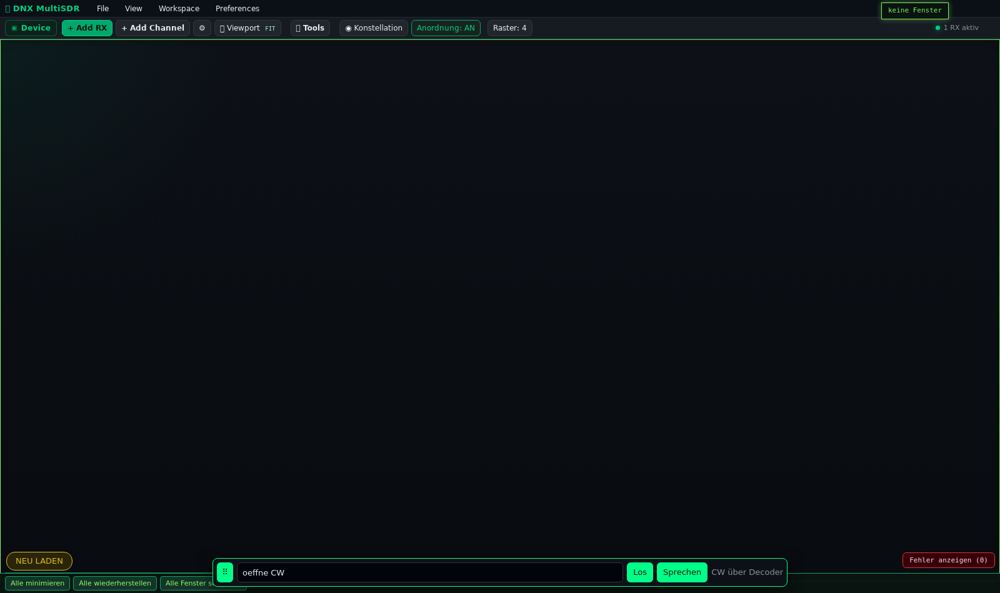

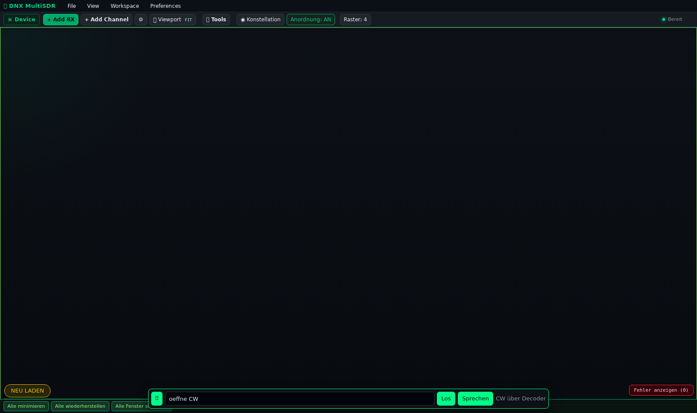

---

## Beobachtete Beta-Eigenheiten (v0.9.0)

- `Preferences → Geräte-Standardwerte` und `Anzeige-Standardwerte für neue RX` zeigen
  **keine sichtbare Wirkung** (Menü schließt sich, nichts öffnet sich).
- `Preferences → FFT Einstellungen` ist ein **Öffner für das FFT-Fenster**, kein
  Einstellungs-Dialog; die FFT-Einstellungen stehen im FFT-Fenster selbst.
- `⚙ Device Defaults` öffnet den Dialog *Receiver hinzufügen* (Auswahl), nicht die Vorgaben.
- `Alle minimieren` erzeugt keine sichtbaren Kacheln (§10).
- Solange `Anordnung: AN` ist, zieht der Packer Fenster automatisch wieder ins Raster —
  für freie Positionierung erst `Anordnung: AUS` schalten.

---

*Nur Dokumentation und Screenshots — MIT-lizenziert (Doku). Die Anwendung selbst ist
nicht Teil dieser Veröffentlichung. DNX MultiSDR ist ein Hobbyprojekt ohne Support;
Nutzung auf eigene Gefahr — siehe [disclaimer.md](disclaimer.md).*
