# ADD RX & Decoder im Detail

Diese Seite beschreibt **jedes Empfänger-Modul und jedes Dekoder-Fenster**, das DNX
MultiSDR mitliefert — mit echten Screenshots aus der Live-App. Die Dekoder-Fenster
sind **nicht** Teil des Tools-Menüs und nicht Teil von `+ Add Channel`; sie werden
über die **Befehlsleiste** (unten in der App) geöffnet:

```
oeffne AIS | oeffne DMR | oeffne APRS | oeffne ADS-B | oeffne D-STAR | oeffne M17
oeffne SSTV | oeffne RTTY | oeffne CW | oeffne DAB | oeffne TETRA | oeffne P25
oeffne NXDN | oeffne ILS | oeffne VOR
```

Der volle Absichtstext steht als Platzhalter in der Leiste (`oeffne AIS | karte 3d |
wetter | scan | oeffne DMR`). Tippen, `los` klicken — die Fenster öffnen sich an das
Raster angebunden (Standard 396 × 400 px). Enthält die Eingabe keine bekannte
Dekoder-Anweisung, passiert einfach nichts.

> **Hinweis:** Die Befehle `karte 3d`, `wetter` und `scan` öffnen in dieser Beta
> nur ein generisches Wasserfall-Fenster des aktiven RX. Die echten Werkzeuge
> erreichst du über `+ Add Channel` (Wetter) bzw. das `Tools`-Menü (Scanner) — siehe
> [wetter.md](wetter.md) und [tools.md](tools.md).
>
> **Rechtliches:** Alle Screenshots zeigen entweder den hardwarefreien
> `DSP Test Source`-RX (nur Layout/Funktion) oder einen echten Empfangslauf
> (ADS-B auf 1090 MHz mit RTL-SDR Blog V3). Es wird **keine** Sprache/Daten
> gesendet, mitgehört oder entschlüsselt, die nicht öffentlich ist oder dir
> gehört. Siehe [disclaimer.md](disclaimer.md).

---

## Add RX — Empfänger hinzufügen

`+ Add RX` (grün, oben links) öffnet den Dialog **Receiver hinzufügen**:

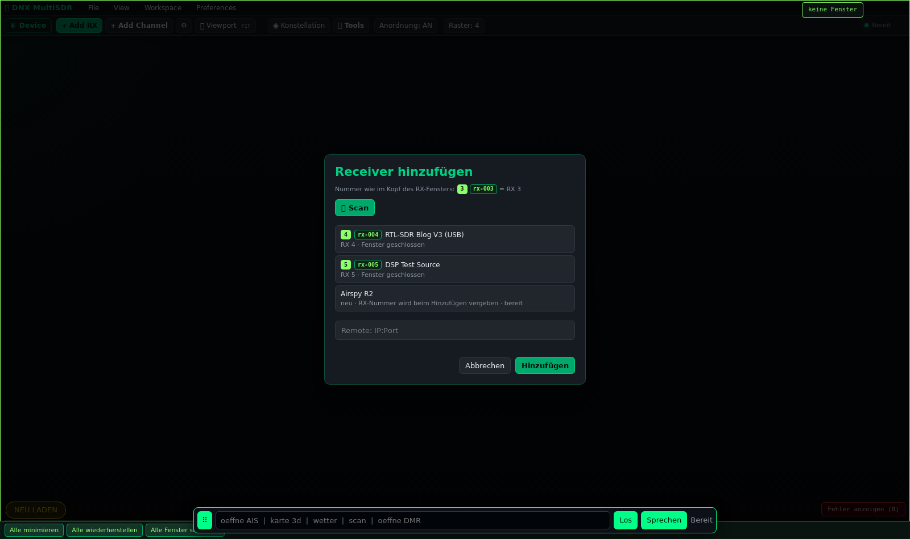

- **RTL-SDR Blog V3 (USB)** — echtes Gerät (hier `rx-004 · Fenster geschlossen`);
  `+` richtet es auf 1 090 / 433,9 MHz o. ä. ein
- **DSP Test Source** — simuliertes HF-Rauschen/Signal ohne Hardware; ideal zum
  Anordnen, Ausprobieren und für diese Doku
- **Airspy R2** — Eintrag vorhanden, in dieser Beta als *neu* markiert (Nummer
  wird beim Hinzufügen vergeben, Status *bereit*)
- **Remote: IP:Port** — direktes Einbinden eines entfernten DNX-DSPs über Netz

`🔍 Scan` sucht angeschlossene Geräte erneut. **`Hinzufügen`** übernimmt die Auswahl
und öffnet das zugehörige RX-Fenster (`PLAY`-Widget, 396 × 400 px). Die Liste der
offenen/geschlossenen Fenster pro Gerät steht unten in jedem Eintrag; die Nummern
(`rx-002`, `rx-005` …) erscheinen im Kopf jedes daran gebundenen Fensters.

**Modes im RX-Fenster** (Dropdown `Mode`, gilt für alle Dekoder):

| Mode | Bedeutung |
|---|---|
| NFM | Schmalband-FM (Sprache, 12,5/25 kHz Raster) — Standard für VHF/UHF-Funk |
| WFM | Breitband-FM (UKW-Hörfunk) |
| AM | Amplitudenmodulation (Flugfunk, Kurzwelle) |
| SAM | Synchron-AM (bessere Selektivität bei Kurzwelle/Schwankfading) |
| USB / LSB | Einseitenband (Kurzwelle, Flugfunk > 10 MHz meist USB, < 10 MHz LSB) |
| CW | Morsetelegrafie (sehr schmalbandig, 100–500 Hz) |
| Bypass | Keine Demodulation — rohes I/Q / Analyse |

Dazu `SQ` (Squelch, `OPEN`/`AUTO`), `Vol`, `■ STOP`, `PLAY`/`⊞+ MARKER` (Marker setzen),
Frequenzanzeige mit Fein-Schritt (`+/−`), Band-Presets-Chips (`Channels`, z. B.
`LPD433`, `70cm`, `ADS-B`), sowie Squelch/AGC/Empfangspegel (`PEGEL`, `Kontrast`,
`Bereich`, `Versatz`).

---

## AIS — Automatic Identification System (Schiffe)

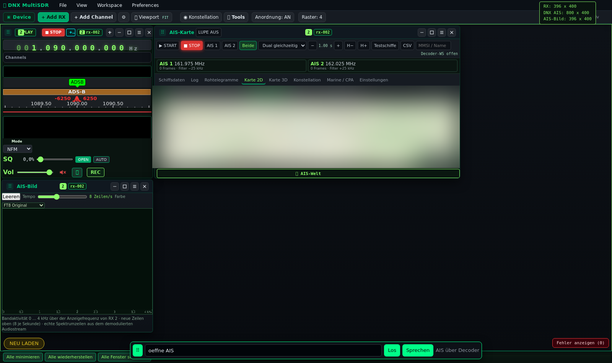

`oeffne AIS` öffnet zwei Fenster: **AIS-Karte** (Steuerung + Karte + Daten) und
**AIS-Bild** (Wasserfall).

- **Frequenzen:** AIS 1 = 161,975 MHz, AIS 2 = 162,025 MHz — Schalter `AIS 1` /
  `AIS 2` / `Beide` (Dual gleichzeitig), Frequenzsprung `±1,00 s`, Buttons `H−` /
  `H+` für Grob-Tuning, `− Testschiffe` erzeugt synthetische Schiffsziele ohne Hardware
- **Statuszeilen:** `0 Frames · Ticker → 25 kHz` (Frame-Zähler, Frequenzraste)
- **Tabs:** `Schiffsdaten | Log | Rohtelegramme | Karte 2D | Karte 3D | Konstellation | Marine / CPA | Einstellungen`
- **Karte 2D/3D:** OpenStreetMap-Basiskarte mit Ebenen-Leiste (`2D · 3D · BEIDE · Alle Ziele · Start · Spuren · Namen · OSM · Ebenen · Menü`).
  *In dieser Veröffentlichung ist der Kartenausschnitt bewusst weichgezeichnet,
  weil er den Standort der Empfangsstation preisgeben würde — es ist derselbe
  Standort wie bei allen anderen Fenstern mit Karteneinzug.*
- **Export:** `CSV` (Schiffsliste), `MMSI / Name` (Namens-Auflösung)
- `Decoder-WS: offen` — die Dekodierung läuft als WebSocket-Dienst; die App
  verbindet sich automatisch
- `Konstellation` — Phasenkonstellation der demodulierten Bits (Diagnose)

**Zweck:** Schiffsverfolgung auf See/Binnenwasserstraßen. AIS ist öffentlich
ausgestrahlt; trotzdem gilt: keine sonstige Nutzung der Daten behauptet die App —
sie stellt sie nur dar.

---

## DMR — Digital Mobile Radio (weltweite Frequenzliste)

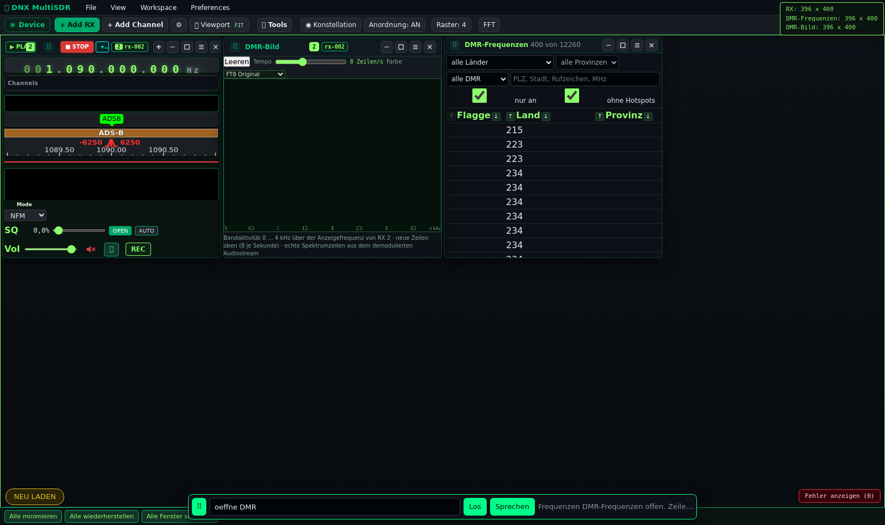

`oeffne DMR` öffnet **DMR-Frequenzen** und **DMR-Bild**.

- **Welt-Datenbank** mit **12.260** Einträgen; Header zeigt den *aktiven* Filter
  (hier `400 von 12260` — also 400 sichtbar wegen aktivem Filter)
- **Filter:** `alle Länder` (Flaggen-Dropdown), `alle Provinzen`, `alle DMR`
  (Gerätetyp); Suche nach `PLZ, Stadt, Rufzeichen, MHz`
- Checkboxen **`nur an`** (nur aktive/belegte Einträge) und **`ohne Hotspots`**
  (private Internet-Hotspots ausblenden)
- Tabelle sortierbar (Flagge, Land, Provinz …), Zeilen anklickbar — ein Klick
  stimmt den RX auf die gewählte Frequenz ab
- **DMR-Bild:** Wasserfall-ähnliche Bandaktivität (Farbe `FT8 Original`, `8 Zeilen/s`)

**Zweck:** Auffinden von DMR-Relais-/Simplexfrequenzen weltweit. Die Daten sind
nö-Listen öffentlicher Relaisdatenbanken; Verbindungscodes/Talkgroups werden
nicht entschlüsselt.

---

## APRS — Automatic Packet Reporting System

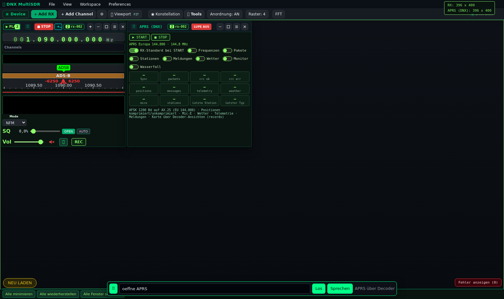

`oeffne APRS` öffnet **APRS (DNX)**.

- Vorgabe: **Europa 144,800 MHz**; Schalter **`RX-Standard bei START`** merkt die
  Frequenz als Standard für den START-Button
- Toggle-Row: `Frequenzen`, `Pakete`, `Stationen`, `Meldungen`, `Wetter`,
  `Monitor`, `Wasserfall`
- **Statistik-Kacheln** (alle `—`, solange kein Verkehr empfangen wird):
  `Sync · packets · crc ok · crc err · positions · messages · telemetry · weather · mice · stations · letzte Station · letzter Typ`
- Fußtext: *AFSK 1200 Bd auf AX.25 (EU 144.800) · Positionen
  komprimiert/unkomprimiert · Mic-E · Wetter · Telemetrie · Meldungen ·
  Karte über Decoder-Ansichten (records)*

**Zweck:** Digitale Positions-/Telemetrie-Pakete im 2-Meter-Amateurfunkband.
APRS ist öffentlich; private Nachrichten (`messages`) anderer Teilnehmer
wiederzugeben wäre — wie überall — nicht in Ordnung; die App zeigt nur, was
den Kanal verlässt.

---

## ADS-B — Flugzeug-Positionen (1090 MHz)

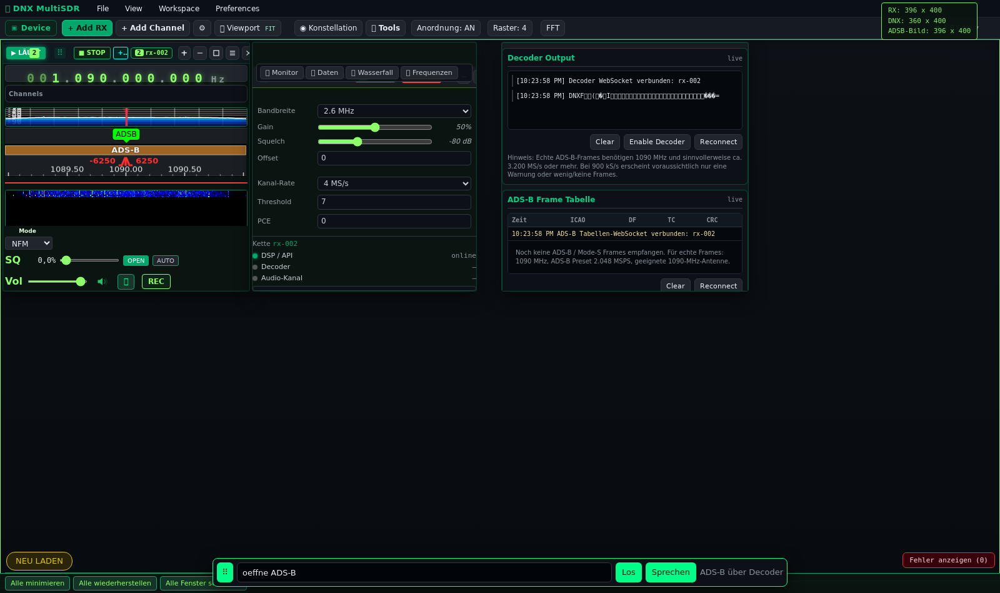

`oeffne ADS-B` öffnet den **DNX Demodulator (ADSB)** (hier ein echter Lauf mit
RTL-SDR Blog V3 auf 1090,000 MHz, PLAY aktiv).

- **Tabs:** `Monitor | Daten | Wasserfall | Frequenzen`
- **Parameter:** `Bandbreite 2,6 MHz`, `Gain 50 %`, `Squelch −80 dB`,
  `Offset 0`, `Kanal-Rate 4 MS/s`, `Threshold 7`, `PCE 0`
- **Kette:** `rx-002` mit Statuspunkten `DSP / API · online`, `Decoder`, `Audio-Kanal`
- **Decoder-Log** (live): z. B. `[10:23:58 PM] Decoder WebSocket verbunden: rx-002`
- **ADS-B Frame Tabelle:** Spalten `Zeit · ICAO · DF · TC · CRC`, dazu
  `Clear`, `Enable Decoder`, `Reconnect`
- **Hinweistext in der App:** *Echte ADS-B-Frames benötigen 1090 MHz und
  sinnvollerweise ca. 3.200 MS/s oder mehr. Bei 900 kS/s erscheint voraussichtlich
  nur eine Warnung oder wenig/keine Frames.*

**Zweck:** Flugzeug-Ortung in Echtzeit. ADS-B sendet absichtlich unverschlüsselt;
die App liest ausschließlich den eigenen Empfang, kein externes Tracking.

---

## D-STAR — Digitaler Sprach-/Datenfunk

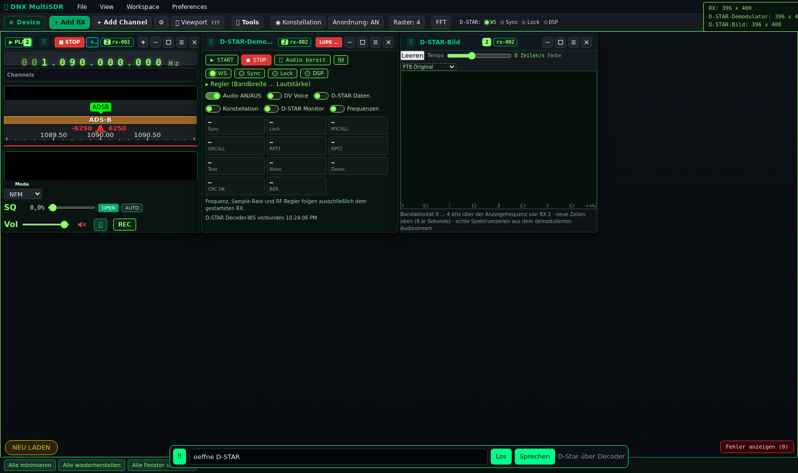

`oeffne D-STAR` öffnet **D-STAR-Demodulator** und **D-STAR-Bild**.

- **Modi/Status:** `Audio bereit`, Leuchtdioden `WS · Sync · Lock · DSP`
- **Regler:** Bandbreite, Lautstärke; Toggles `Audio AN/AUS`, `DV Voice`,
  `D-STAR Daten`, `Konstellation`, `D-STAR Monitor`, `Frequenzen`
- **Felder:** `Sync · Lock · MYCALL · URCALL · RPT1 · RPT2 · Text · Voice ·
  Daten · CRC OK · BER`
- Statuszeile: *Frequenz, Sample-Rate und RF-Regler folgen ausschließlich dem
  gestarteten RX.* / `D-STAR Decoder-WS verbunden …`

**Zweck:** D-STAR DV (Sprache/Daten). Dekodierung nur eigener/öffentlicher
Rufe; keine Entschlüsselung privater Verkehre.

---

## M17 — offenes digitales Sprachprotokoll

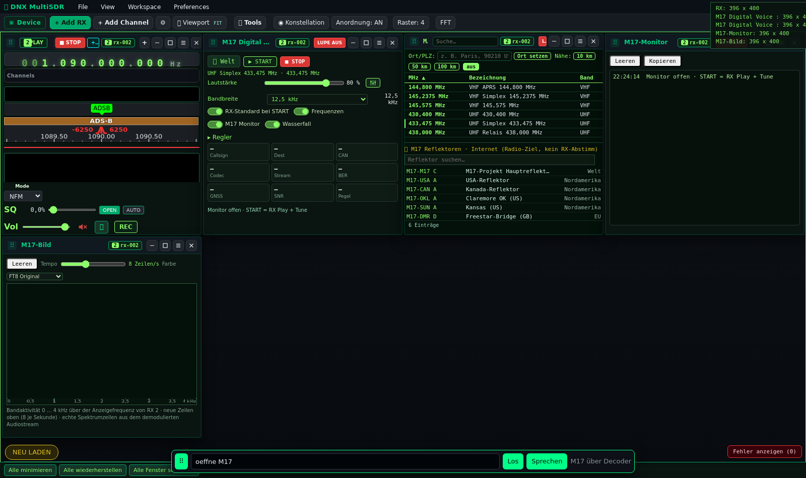

`oeffne M17` öffnet bis zu fünf Fenster: **M17 Digital Voice (DNX)**,
**M17 Digital Voice Frequenzen**, **M17-Monitor**, **M17-Bild** (Wasserfall).

- Vorgabe: **UHF Simplex 433,475 MHz**; `Lautstärke 80 %`, `Bandbreite 12,5 kHz`
- Toggles: `RX-Standard bei START`, `Frequenzen`, `M17 Monitor`, `Wasserfall`,
  dazu `🌍 Welt` (Länderumschaltung der Preset-Liste)
- **Frequenz-Presets** (Ort/PLZ-Suche, `Nähe: 10 / 50 / 100 km / aus`):
  144,800 VHF · 145,2375 / 145,575 / 430,400 / 433,475 / 438,000 UHF (Simplex,
  Relais) — Spalten `MHz · Bezeichnung · Band`
- **M17-Reflektoren** (Internet-Ziele, **kein RX-Abstimm**):
  `M17-M17 C` (Hauptreflektor), `M17-USA A` (USA), `M17-CAN A` (Kanada),
  `M17-OKL A` (Claremore, OK), `M17-SUN A` (Kansas, US), `M17-DMR D`
  (Freestar-Bridge GB) — rein als Liste/Referenz
- **M17-Monitor:** Log mit `START = RX Play + Tune`, `Leeren`, `Kopieren`
- **Felder:** `Callsign · Dest · CAN · Codec · Stream · BER · GNSS · SNR · Pegel`

**Zweck:** M17 ist das offene (patentfreie) digitale Sprachformat des
Amateurfunks — DNX MultiSDR dekodiert die eigene Verbindung bzw. öffentliche
Rufe; Netz-Reflextoren werden nur gelistet.

---

## CW — Morsetelegrafie-Decoder

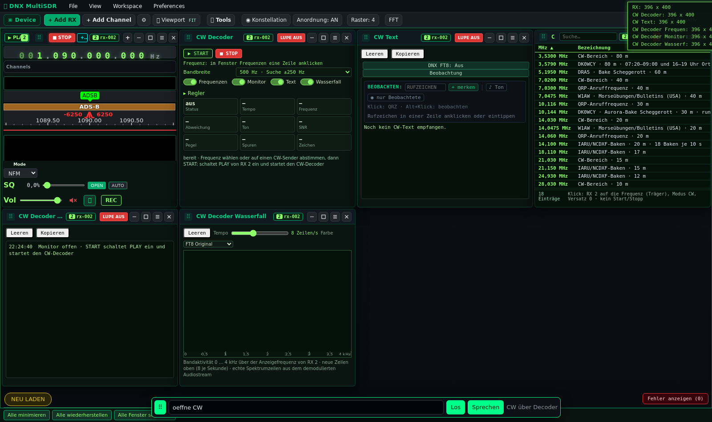

`oeffne CW` öffnet bis zu fünf Fenster: **CW Decoder**, **CW Text**,
**CW Decoder Monitor**, **CW Decoder Frequenzen**, **CW Decoder Wasserfall**.

- **Hinweis in der App:** *Frequenz: im Fenster Frequenzen eine Zeile anklicken* —
  der Decoder startet **nicht** auf der Geblink-Frequenz, sondern auf der explizit
  gewählten Zeile
- **Bandbreite:** `500 Hz · Suche ±250 Hz` (Dropdown)
- Toggles: `Frequenzen · Monitor · Text · Wasserfall`
- **Felder:** `aus Status · Abweichung · Pegel · Tempo · Ton · SNR · Spuren · Zeichen`
- **Textfenster** mit Beobachtung: Spalten `DNX FT8: Aus`, `Beobachtung`,
  `BEOBACHTEN: RUFZEICHEN` (`+ merken`, `♪ Ton`, `◉ nur Beobachtete`);
  *„Klick: QRZ · Alt+Klick: beobachten — Rufzeichen in einer Zeile anklicken oder eintippen“*
- **Monitor:** `HH:MM:SS Monitor offen · START schaltet PLAY ein und startet den CW-Decoder`
- **Presets** (`18 Einträge`): 3,5300 MHz (80 m CW-Bereich), 3,5790 (DK0WCY,
  07:28-09:00 und 16-19 Uhr Bake), 5,1950 (DRAAS Bake Scheggerott), 7,0200/7,0300/
  7,0475 (40 m, W1AW), 10,116/10,144 (30 m, CW-Bereich/DK0WCY), 14,030/14,075/
  14,060/14,100/18,110/21,030/21,150/24,930/28,030 — Amateur- und IARU/NCDXF-Baken
- Fußzeile: `Klick: RX 2 auf die Frequenz (Träger), Modus CW, Versatz 0 · kein Start/Stopp`

**Zweck:** Automatisches Mitlesen von CW (Morse) im Amateur- und Bakenverkehr;
das BEOBACHTEN-Merksystem filtert auf Rufzeichen, die dich interessieren.

---

## RTTY — Funkfernschreiben (45 Baud / 170 Hz)

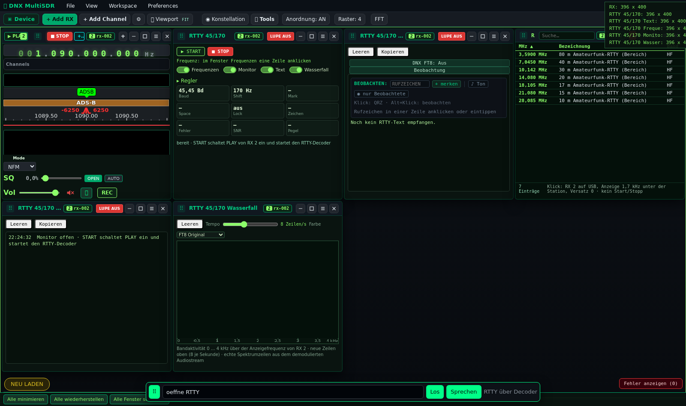

`oeffne RTTY` öffnet bis zu fünf Fenster: **RTTY 45/170**, **RTTY 45/170 Text**,
**RTTY 45/170 Monitor**, **RTTY 45/170 Frequenzen**, **RTTY 45/170 Wasserfall** —
gleiches Bedienkonzept wie der CW-Decoder, gleiche Beobachtungslogik (`BEOBACHTEN`,
`+ merken`, `Klick: QRZ`).

- **Parameter:** `45,45 Bd` (Dropdown), **Shift `170 Hz`**, Anzeige `Mark / Space`,
  `aus Lock`-Meldung, Felder `Zeichen · Fehler · SNR · Pegel`
- **Hinweis:** *„Frequenz: im Fenster Frequenzen eine Zeile anklicken“*
- **Presets** (`7 Einträge`, Amateurfunk RTTY, HF): 3,5900 · 7,0450 · 10,142 ·
  14,080 · 18,105 · 21,080 · 28,085 MHz
- Fußzeile: `Klick: RX 2 auf USB, 1,7 kHz unter der Station, Versatz 0 · kein Start/Stopp`

**Zweck:** Klassischer Funkfernschreiberempfang (u. a. Kurzwellen-RTTY,
Bakebetrieb, Contests).

---

## SSTV — Amateurfunk-Fax (Bilder)

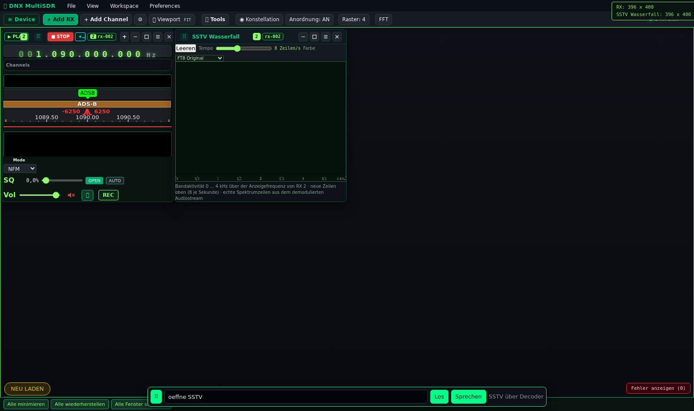

`oeffne SSTV` öffnet aktuell das **SSTV Wasserfall**-Fenster (Farbschema
`FT8 Original`, `8 Zeilen/s`, Tempo-Regelung + `Leeren`). Die eigentliche
Zeilen-/Synchron-Dekodierung und Bildrekonstruktion läuft im DSP-Dekoder-Prozess.

**Zweck:** Empfang von SSTV-Bildern aus dem Amateurfunk (z. B. ISS-Überflüge,
Simplex-Runden).

---

## DAB — Digital Audio Broadcasting

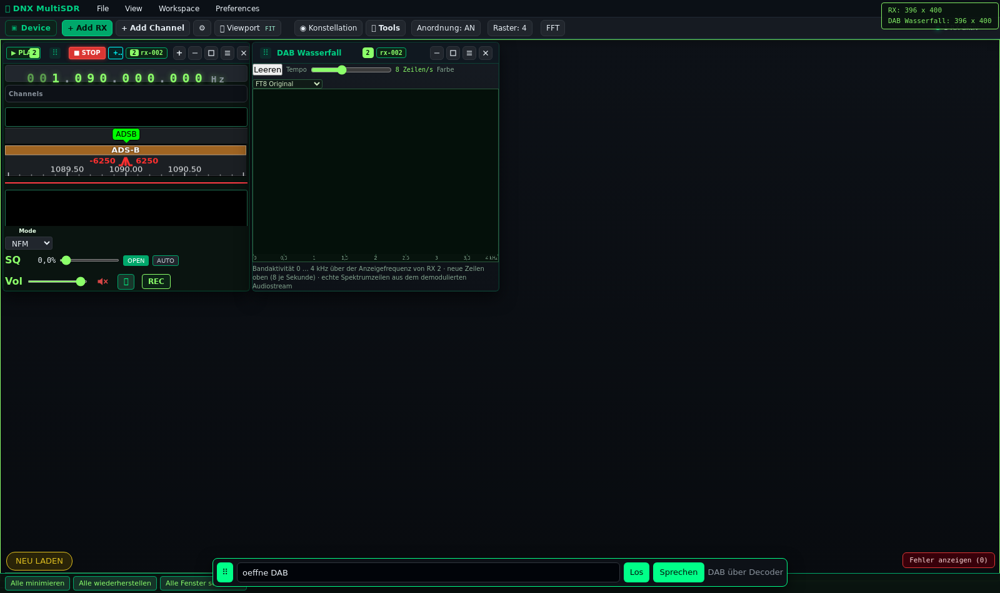

`oeffne DAB` öffnet das **DAB Wasserfall**-Fenster (gleicher Wasserfall-Baustein
wie bei allen Dekodern). Die DAB/DAB+-Demodulation (ZF, OFDM, MSE, MSC/FIC,
Ensemble-Informationen) läuft im separaten **`dnx-dab`-Container** — siehe
[installation.md](installation.md). Für DAB brauchst du also die volle Docker-
Umgebung, nicht nur die RTL-SDR-Anbindung.

**Zweck:** Digitaler Hörfunk im Band III / L-Band (je Region).
**Rechtlich:** DAB ist frei empfangbar; Vervielfältigung/Veröffentlichung der
gesendeten Programme ist Sache der Sender bzw. der Urheberrechts-Inhaber.

---

## TETRA — digitalisierte Bündelfunknetze

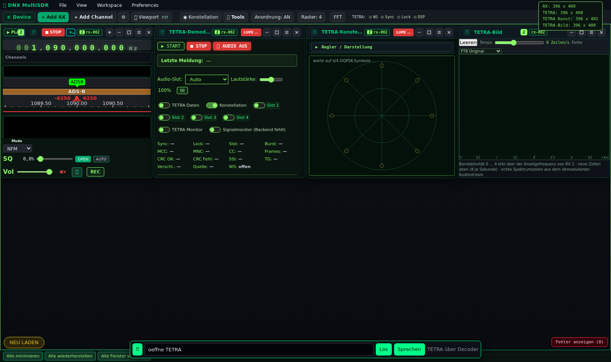

`oeffne TETRA` öffnet **TETRA-Demodulator**, **TETRA-Konstellation** und **TETRA-Bild**.

- **Steuerung:** `START / STOP`, großes Rot-Feld `AUDIO AUS` (Standard; Audio nur
  bewusst zuschaltbar), `Letzte Meldung: —`, `Audio-Slot: Auto` (Dropdown
  `nur Slot 1 … 4`), Lautstärke `100 %`
- Toggles: `TETRA Daten · Konstellation · Slot 1 · Slot 2 · Slot 3 · Slot 4 ·
  TETRA Monitor · Signalmonitor (Backend fehlt)`
- **Felder:** `Sync · Lock · Slot · Burst · MCC · MNC · CC · Frames · CRC OK ·
  CRC Fehl. · SSI · TG · Verschl. · Quelle · WS: offen`
- **Konstellation:** π/4-DQPSK-Diagramm (8 Punkte), Regler `Nachleuchten 50 ·
  Punkt 2 · Tempo 100 · Skala 45 · Helligkeit 60 · Spur 0 · Glättung 0 ·
  Dichte 0`, `Ansicht: ● Live Punkte`

> **Rechtliches (wichtig):** TETRA trägt u. a. Behörden- und Betriebsfunk.
> Verschlüsselte Verbindungen werden von dieser App **nicht** entschlüsselt und
> dürfen es nicht — eine Entschlüsselung ist weder implementiert noch legal
> zulässig. DNX MultiSDR zeigt Frame-Metadaten unverschlüsselter, eigener oder
> autorisierter Netze (Labor, eigene Anlage, Schulungsumgebungen). Siehe
> [disclaimer.md](disclaimer.md).

---

## P25 — Project 25 (digitalisierter Sprechfunk)

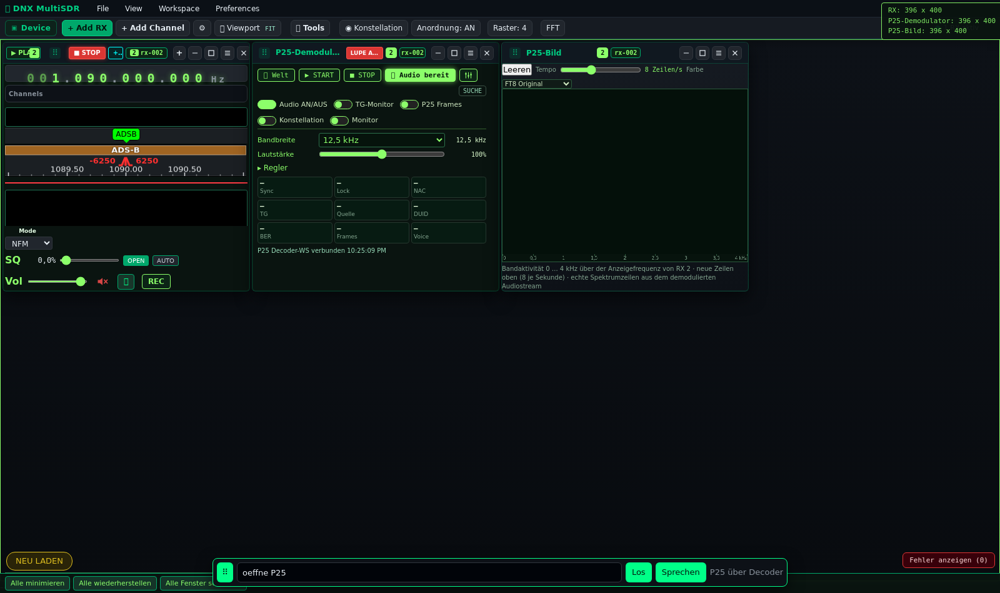

`oeffne P25` öffnet **P25-Demodulator** und **P25-Bild**.

- START/STOP, **`Audio bereit`**-Leuchte, `Audio AN/AUS`, `TG-Monitor`,
  `P25 Frames`, `Konstellation`, `Monitor`, `🌍 Welt`, `SUCHE`
- **Bandbreite:** `12,5 kHz`, Lautstärke `100 %`
- **Felder:** `Sync · Lock · NAC · TG · Quelle · DUID · BER · Frames · Voice`
- Statuszeile: `P25 Decoder-WS verbunden …`, Frames-Tabelle analog zum ADS-B
  (Live-Framezähler)

**Zweck:** P25-Sprechfunk (v. a. Nordamerika). Wie bei TETRA gilt: nur
unverschlüsselte/eigene/autorisierte Kommunikation — Entschlüsselung findet
nicht statt.

---

## NXDN — Standard für schmale Kanäle


`oeffne NXDN` öffnet das **NXDN-Bild** (Wasserfall, `FT8 Original`, Tempo,
`Leeren`). Die Dekoder-Pipeline läuft im DSP-Backend.

**Zweck:** NXDN-Sprechfunk (Kenwood/Icom, 6,25/12,5 kHz Raster) — wieder nur
eigen/autorisierte, unverschlüsselte Verkehre.

---

## ILS — Instrument Landing System (Landebahn-Anflug)

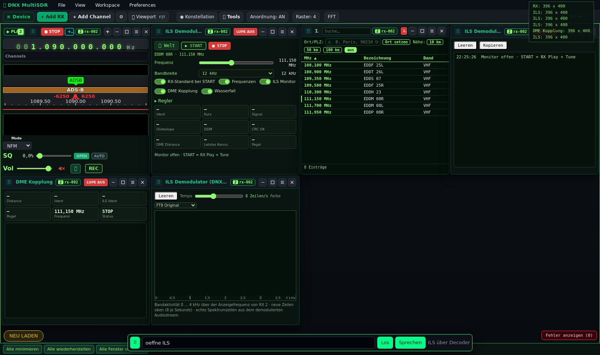

`oeffne ILS` öffnet bis zu vier Fenster: **ILS Demodulator (DNX)**, **ILS Frequenzen**,
**ILS Monitor**, **DME Kopplung**.

- Gewählter Anflug: **EDDM 08R · 111,150 MHz** (Zielbalken-Modus)
- **Welt-Preset-Liste** (`Ort/PLZ`-Suche, `Nähe`, `MHz/Bezeichn./Band`):
  108,100 EDDF 25L · 108,900 EDDT 26L · 109,350 EDDS 07 · 109,500 EDDF 25R ·
  110,300 EDDM 23 · **111,150 EDDM 08R** · 111,700 EDDM 08L · 111,950 EDDP 08R
  (`8 Einträge`)
- **Bandbreite:** `10 kHz / 12 kHz`; Toggles `RX-Standard bei START`, `Frequenzen`,
  `ILS Monitor`, `DME Kopplung`, `Wasserfall`
- **Felder:** `Ident · Kurs · Signal · Glideslope · DDM · CRC OK · DME Distance ·
  Letztes Kennz. · Pegel`
- **DME Kopplung** (Koppel-Fenster): `Distance · Ident · ILS Ident · Pegel ·
  Frequenz 111,150 MHz · STOP · Status` — zeigt die DME-Entfernung zum Sender
- **Monitor:** `HH:MM:SS Monitor offen · START = RX Play + Tune`
- **Ortszeit-Dialog:** Sendezeiten sind UTC — der Dialog `Ortszeit für die
  Sendezeiten` fragt beim ersten Öffnen (`UTC` / `MEZ` / eigene Auswahl); siehe
  [wetter.md](wetter.md#hf-fax--sendezeiten--utc-vs-mez)

**Zweck:** Flugfunk-Navigationsdienst (Landesystem). ILS/LOC-Signale sind
öffentlich; Beobachtung zu Lern- und Demonstrationszwecken.

---

## VOR — VHF Omnidirectional Range (Drehfunkfeuer)

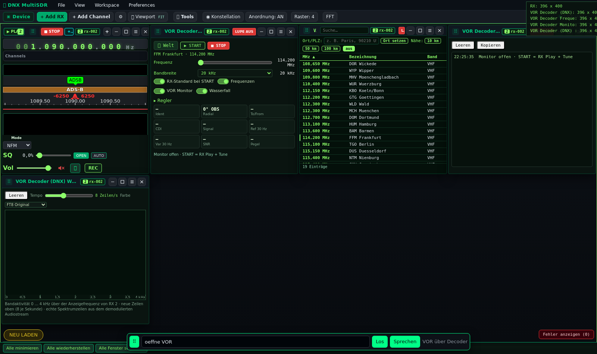

`oeffne VOR` öffnet bis zu vier Fenster: **VOR Decoder (DNX)**, **VOR Frequenzen**,
**VOR Monitor**, **VOR Wasserfall** — Bedienkonzept identisch zum ILS-Dekoder.

- Gewählt: **FFM Frankfurt · 114,200 MHz**
- **Welt-Preset-Liste** (`19 Einträge`): DOR Wickede 108,650 · WYP Wupper
  109,600 · MGW Moenchengladbach 109,800 · WUR Wuerzburg 110,400 · KBD Koeln/Bonn
  112,150 · GTG Goettingen 112,200 · WLD Wald 112,300 · MCH Muenchen 112,300 ·
  DOM Dortmund 112,700 · HUM Hamburg 113,100 · BAM Barmen 113,600 · FFM Frankfurt
  114,200 · TGO Berlin 115,100 · DUS Duesseldorf 115,150 · NTM Nienburg 115,400 …
- **Felder:** `Ident · 0° OBS · Radial · CDI · To/From · Signal · Ref 30 Hz ·
  Ref 30°… · SNR · Pegel`
- **Bandbreite:** `10 / 12 / 20 kHz`
- **Ortszeit-Dialog** (UTC) wie beim ILS

**Zweck:** Klassisches UKW-Drehfunkfeuer (Flugnavigation). Öffentlich; keine
Flugsicherungs-Dienste oder -Kanäle werden genutzt — nur die ausgestrahlten
VOR-Träger.

---

## SSTV · DAB · NXDN … und was ist mit "NAV"?

In älteren Builds gab es einen Sammelbefehl `oeffne NAV` für
Navigationshilfen — in dieser Beta existiert kein eigenes NAV-Fenster; ILS und
VOR sind die eigenständigen Navigationsdekoder. SSTV, DAB und NXDN öffnen
aktuell "nur" das Wasserfall-/Bildfenster; ihre Dekodier-Pipelines laufen im
Hintergrund (DSP bzw. `dnx-dab`). Die volle, interaktive UI (Frame-Tabelle,
Monitor, Audio) gibt es für ADS-B, AIS, APRS, DMR, D-STAR, M17, CW, RTTY, TETRA,
P25, ILS und VOR.

---

## Merkliste für die Doku-Screenshots

- Fenster-Nummern (`rx-002`) und Uhrzeiten (`22:24:14`) unterscheiden sich von Lauf zu Lauf — das ist Absicht (echtes Beta).
- Persönliche Standorte in Karten (AIS) sind in dieser Veröffentlichung weichgezeichnet.
- Uhrzeitstempel und Frame-Zähler unterscheiden sich von Lauf zu Lauf — das ist Absicht (echtes Beta).
