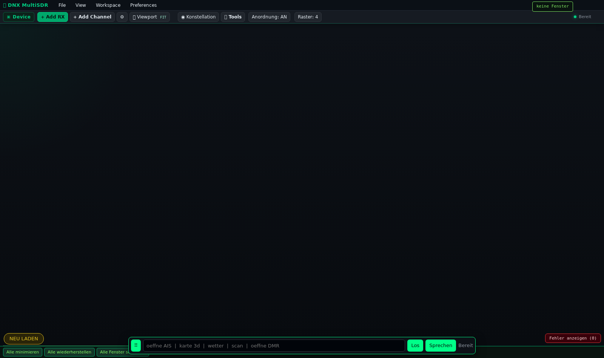
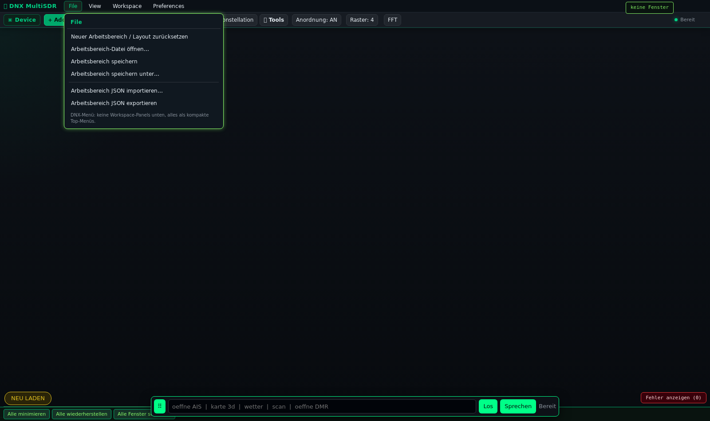
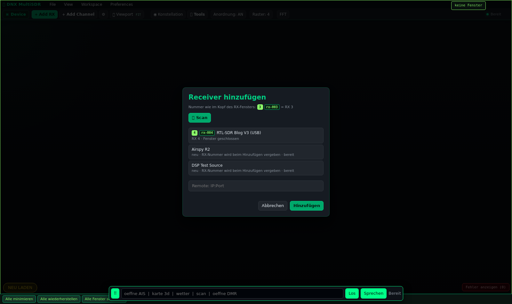
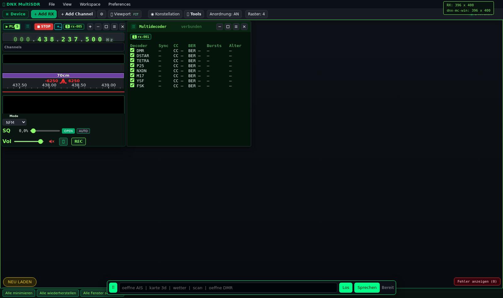

# Erste Schritte — Hauptfenster-Tour



## 1. Menüleiste (oben)

`File · View · Workspace · Preferences` — kompakte Menüs (Details in
[menues.md](menues.md)):

- **File**: Arbeitsbereich (Layout) speichern/laden, JSON-Import/Export, Layout zurücksetzen.
- **View**: Ansicht/Anzeige, Vollbild, alle Fenster minimieren/wiederherstellen/schließen, kaskadieren/kacheln.
- **Workspace**: Anordnung AN/AUS, 4 Arbeitsbereiche (Fenster-Gruppen), Move active RX, Stapel-Layouts, Reiter.
- **Preferences**: FFT-Einstellungen, Geräte- und Anzeige-Standardwerte, Audio-Equalizer, Über DNX MultiSDR.

Rechts oben im Fensterrahmen erscheint der Statusleiste-Hinweis der aktiven Fenster, z. B. `keine Fenster` oder `RX: 396 × 400`.

Unten links `NEU LADEN` lädt die Anwendung komplett neu (harter Reload).



## 2. Toolbar (unter der Menüleiste)

| Element | Funktion |
|---|---|
| **Device** (grün, links) | Zeigt den verbundenen Empfänger / Status des Geräte-Stacks |
| **+ Add RX** | Empfänger hinzufügen (RTL-SDR, Airspy, DSP Test Source, Remote IP:Port) |
| **+ Add Channel** | Kanalpalette öffnen (Satelliten / Sky / Wetter) — siehe [add-channel.md](add-channel.md) |
| ⚙ (Zahnrad) | Geräte-Optionen |
| **Viewport FIT** | Ansicht auf Fenster-Inhalt einpassen |
| **◉ Konstellation** | Satelliten-Konstellation öffnen (3D) |
| **Tools** | Tool-Menü (Welt-DB, Scanner, Manager, Decoder, Band-Browser) — [tools.md](tools.md) |
| **Anordnung: AN/AUS** | Automatische Raster-Anordnung der Fenster an-/ausschalten |
| **Raster: 4** | Fenster-Raster (Spalten-Anzahl) |
| **🔍 Scan** | Scan-Funktion |
| Fenstergrößen-Presets | 800 × 600 … 5120 × 2880 |
| **🌍 Welt** | Welt-Frequenzdatenbank öffnen |
| **⇄ Frequenzen** | Frequenzliste |
| **Fehler anzeigen (0)** | Fehler-Log (unten rechts, rot wenn Einträge) |

Unten links zusätzlich: `Alle minimieren` · `Alle wiederherstellen` · `Alle Fenster schließen`.

## 3. Befehlsleiste (unten mittig)

Die Textzeile versteht Freitextbefehle und steuert die App wie ein Kommandozeilen-Terminal:

```
oeffne AIS | karte 3d | wetter | scan | oeffne DMR
```

Dazu die drei grünen Schaltflächen **`Los`**, **`Sprechen`**, **`Bereit`**:

- **Los** — führt den eingetippten Befehl aus
- **Sprechen** — Spracheingabe für Befehle (Speech-to-Text, anschließend Ausführung)
- **Bereit** — Voice-Standby/Bereitschaftsstatus des Assistenten

## 4. Empfänger hinzufügen (+ Add RX)



Der Dialog `Receiver hinzufügen` listet die verfügbaren Empfänger:

| Eintrag | Beschreibung |
|---|---|
| **RTL-SDR Blog V3 (USB)** | Der angeschlossene RTL-SDR V3 (Chip‑ID RTL2838). Zeigt `RX 4 · Fenster geschlossen`, solange das Fenster zu ist. |
| **Airspy R2** | Airspy R2 (falls angeschlossen) |
| **DSP Test Source** | Synthetische Testquelle ohne Hardware — ideal zum Ausprobieren der Oberfläche |
| **Remote: IP:Port** | Ein im Netzwerk verfügbarer DNX-DSP/RTL-Worker |

Rechts daneben mit `3 · rx-003` wird die nächste freie RX-Nummer angezeigt.
`Scan` versucht angeschlossene SDR-Geräte zu finden. `Hinzufügen` übernimmt die Auswahl.

> **Hinweis zu persistenten RX-Slots:** Die App merkt sich hinzugefügte Empfänger
> (z. B. `rx-003`, `rx-004` …). Fenster lassen sich schließen und wieder öffnen,
> ohne den Empfänger neu anlegen zu müssen.

## 5. Das RX-Fenster

Nach dem Hinzufügen (oder Öffnen) eines RX erscheint ein Fenster im 396 × 400-Raster-Format:

- Oben: farbiger Status (z. B. grünes `PLAY`/rotes `STOP`, RX-Kennung `rx-005`)
- Groß: VFO-Frequenzanzeige (hier `438.237.500 Hz`)
- Frequenzskala mit Bandmarke (violett) und Abweichung (-6250 / +6250)
- **Channels** (Belegungsanzeige)
- **Mode** (unten links: `NFM`, …) und SQ/Squelch + **VOL** Regler
- Buttons `OPEN` / `AUTO`, Lautsprecher, `REC`



> **Hinweis:** Ohne laufenden DSP bleibt `Mode`/Spektrum statisch. Die Testquelle
> `DSP Test Source` liefert synthetische Daten und eignet sich hervorragend zum
> Kennenlernen der Oberfläche — ohne angeschlossene Hardware.

## 6. Fenster-Management

- Fenster sind **frei verschiebbar und skalierbar**; dünner grüner Rand beim aktiven Fenster, doppelte Rahmenlinie = aktives Fenster.
- `Anordnung: AN` legt Fenster automatisch ins **Raster** (Spalten `Raster: n`).
- Über **Workspace**-Menü oder `View` lassen sich alle Fenster gleichzeitig minimieren/wiederherstellen/schließen und Layouts kaskadieren oder kacheln.
- Arbeitsbereiche 1–4 trennen Fenstergruppen (z. B. SAT / Wetter / Scan / HF-Fax).
