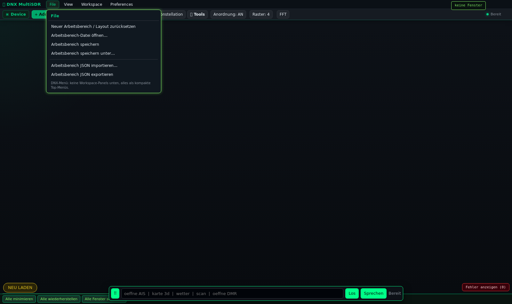
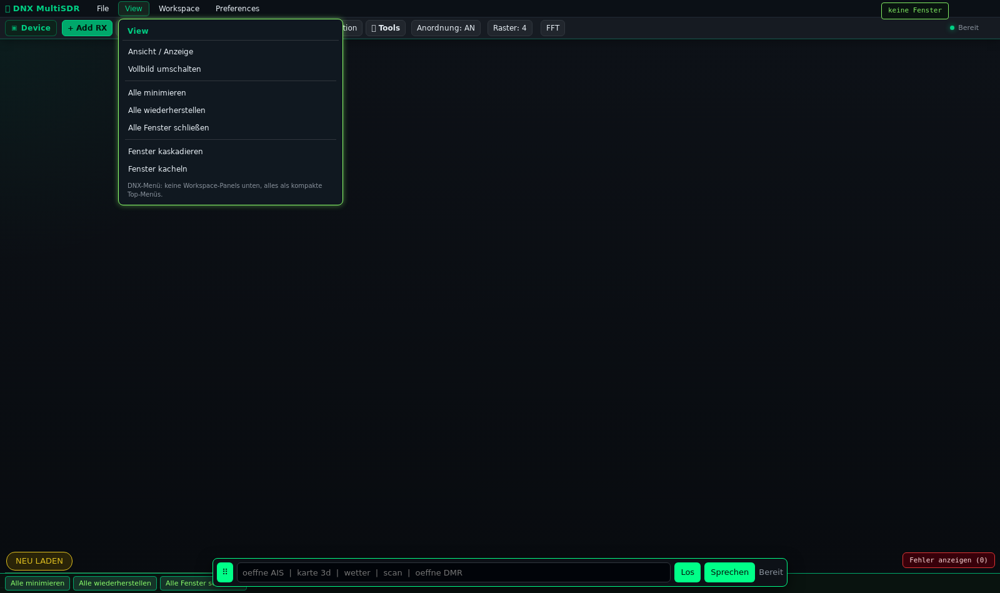
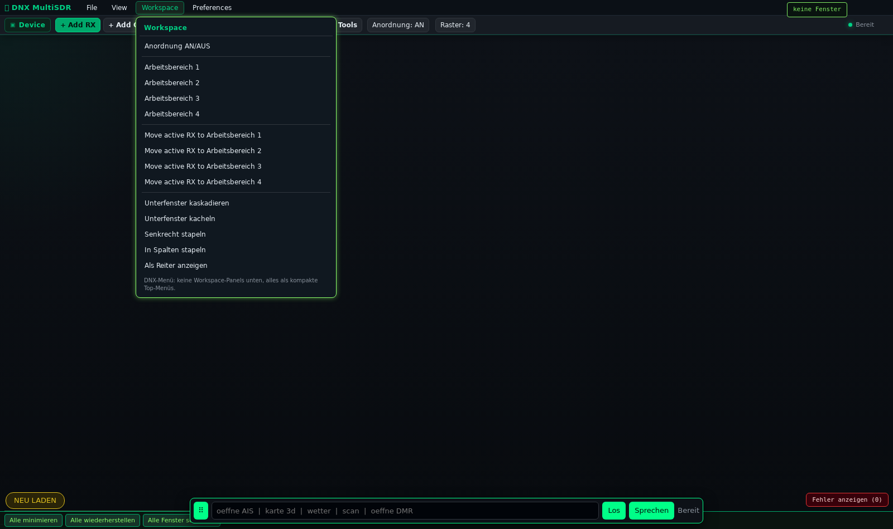
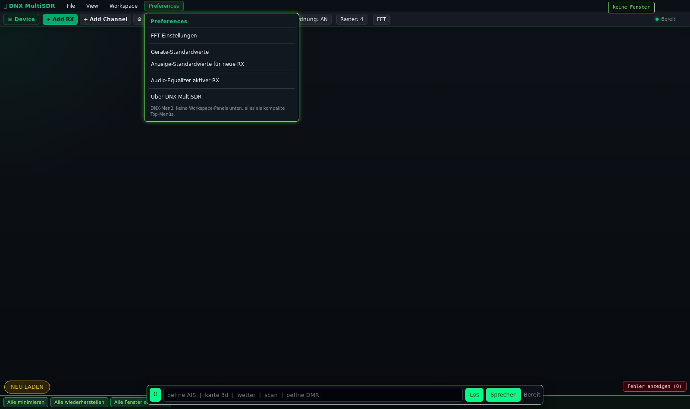
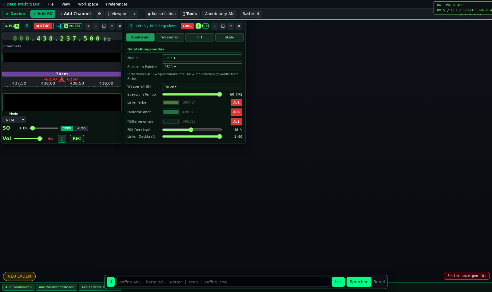

# Menüs im Überblick

## File (`File`)

- `Neuer Arbeitsbereich / Layout zurücksetzen` — kompletter Reset der Fensteranordnung
- `Arbeitsbereich-Datei öffnen…` — gespeichertes Layout laden (Datei wählen)
- `Arbeitsbereich speichern` / `speichern unter…` — Layout per Datei sichern
- `Arbeitsbereich JSON importieren…` / `exportieren` — Layout als JSON (z. B. für Austausch)

Kleiner Hinweistext im Menü: *„DNX-Menü: keine Workspace-Panels unten, alles als
kompakte Top-Menüs.“*

## View (`View`)

- `Ansicht / Anzeige` — Anzeigeoptionen
- `Vollbild umschalten` — Vollbild ein/aus
- `Alle minimieren` / `Alle wiederherstellen` / `Alle Fenster schließen`
- `Fenster kaskadieren` / `Fenster kacheln` — automatische Anordnungen

## Workspace (`Workspace`)

- `Anordnung AN/AUS` — Raster-Anordnung umschalten (wie Toolbar-Button)
- **Arbeitsbereich 1–4** — Fenstergruppe wechseln (z. B. 1 = SAT, 2 = Wetter, 3 = Scan, 4 = Fax)
- **Move active RX to Arbeitsbereich 1–4** — aktiven RX in eine Gruppe verschieben
- `Unterfenster kaskadieren` / `kacheln` / `senkrecht stapeln` / `in Spalten stapeln`
- `Als Reiter anzeigen` — Fenster als Tabs statt freischwebend

## Preferences (`Preferences`)

- `FFT Einstellungen` — FFT/Spektrum-Parameter des aktiven RX
- `Geräte-Standardwerte` — Vorgaben pro Gerät (Gain, AGC, Schwellwerte …)
- `Anzeige-Standardwerte für neue RX` — neue Fenster erhalten diese Defaults
- `Audio-Equalizer aktiver RX` — Klang-EQ pro RX-Kanal
- `Über DNX MultiSDR` — Version/Komponentenliste

## Toolbar-Presets & Raster

Rechts neben `Raster: n` hat die Toolbar Fenstergrößen-Presets (`800 × 600` …
`5120 × 2880`) sowie Ansicht-Hilfen (`⛶ Viewport FIT`, `⟲ Reset`, `⚙ Device Defaults`,
`Anordnung: AN`). `Raster: n` steuert die Spaltenzahl der automatischen Anordnung —
passend zur Fenstergröße der RX-/Tool-Fenster (Standard 396 × 400 px).

Der Toolbar-Button **FFT** öffnet das folgende Analysen-Fenster:

## FFT — Spektrum & Wasserfall des aktiven RX

Der **FFT**-Button öffnet das Fenster **RX <n> / FFT / Spektrum** mit vier Reitern:
`Spektrum`, `Wasserfall`, `FFT`, `Skala`.

*FFT-Fenster (RX 5 · DSP Test Source) mit `Spektrum`-Reiter: Darstellungsmodus `Linie`,
Spektrum-Palette `2511`, Wasserfall-Stil `Farbe`, `Spektrum-Tempo` 60 FPS,
`Linienfarbe`/`Füllfarbe oben`/`Füllfarbe unten` mit Hex-Werten + `AUS`-Schaltern,
`Füll-Deckkraft` 48 %, `Linien-Deckkraft` 1,00. Buttons `Max Hold löschen`,
`Persistenz löschen`, `Spektrum zurücksetzen`.*

`Viewport FIT` zeichnet Inhalt passend zur Fenstergröße, `Reset` stellt die
RX-Parameter auf Standard zurück (Gain, AGC, Empfangspegel), `⚙ Device Defaults`
ruft die gespeicherten Geräte-Vorgaben auf.
