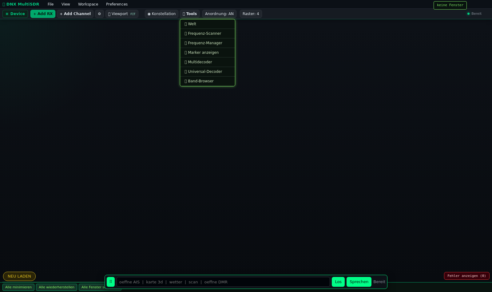
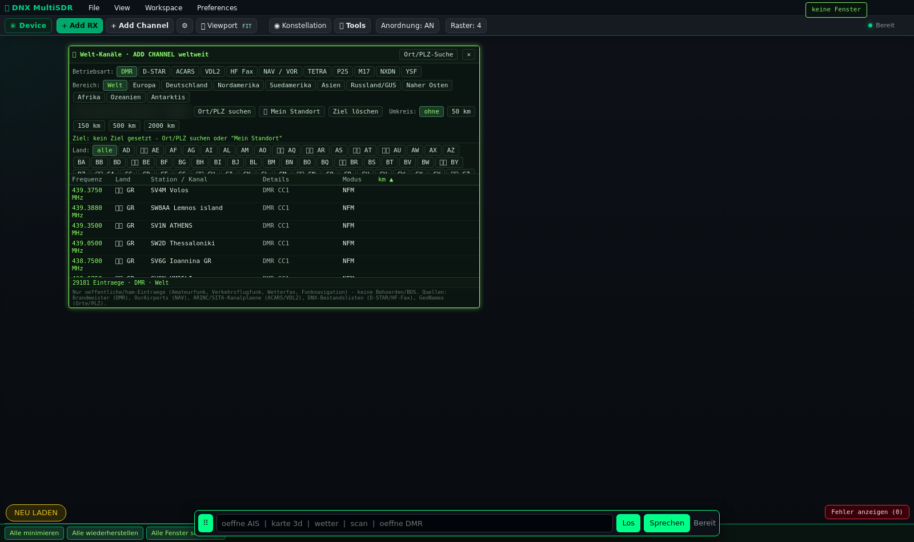
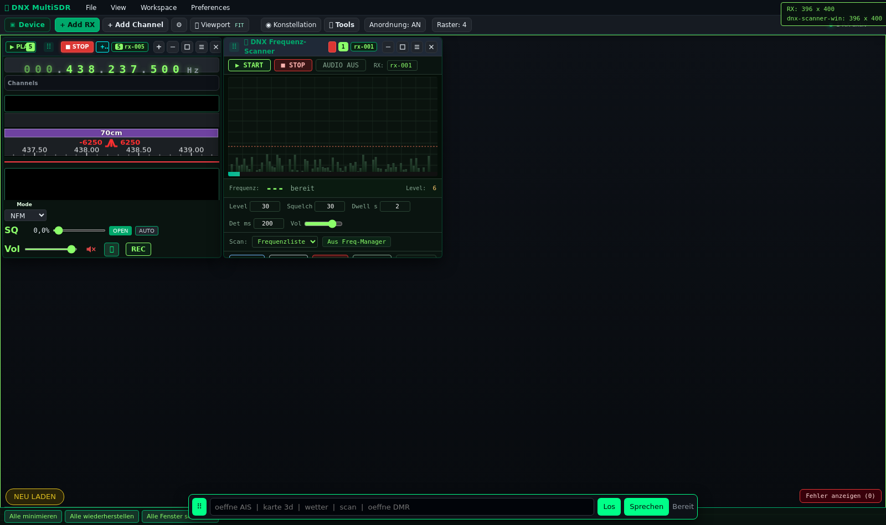
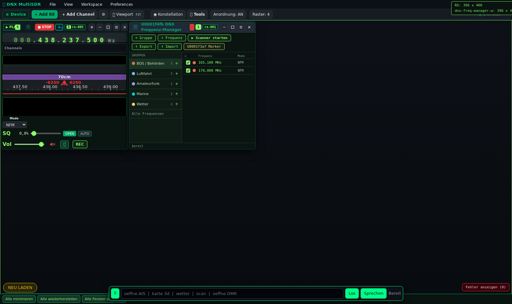
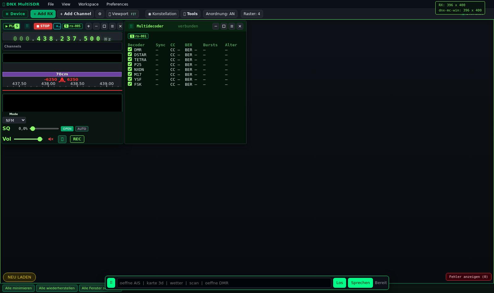
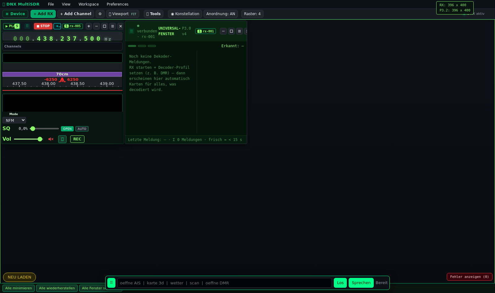
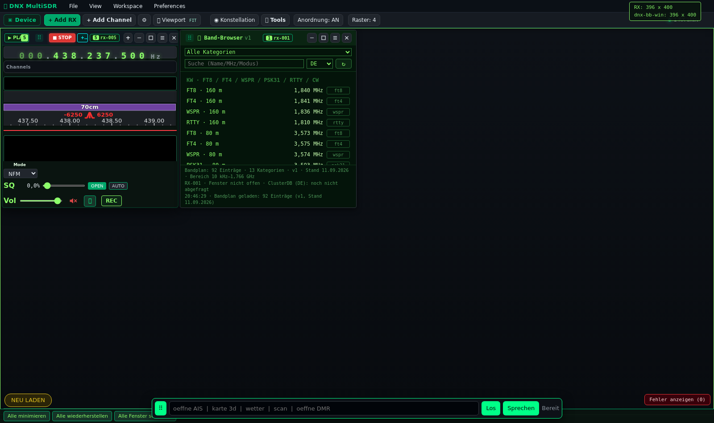

# Tools — Menü im Detail

`Tools` (Toolbar) öffnet ein Dropdown mit sieben Werkzeugen. Unten in der
Befehlsleiste stehen dieselben Befehle als Text zur Verfügung (z. B. `wetter`,
`scan`, `oeffne AIS` …; vollständige Decoder-Liste: [decoder.md](decoder.md)).

Reihenfolge im Menü:

1. **🌍 Welt**
2. **🔍 Frequenz-Scanner**
3. **📻 Frequenz-Manager**
4. **🎯 Marker anzeigen**
5. **📡 Multidecoder**
6. **🧬 Universal-Decoder**
7. **📚 Band-Browser**

> **Hinweis zu Fenstern:** Die meisten Tools öffnen als eigenes Fenster im
> 396 × 400-Raster und sind an einen RX gekoppelt (`rx-001` …). Ohne aktiven RX
> zeigen sie entweder den leeren Grundzustand oder öffnen den Receiver-Dialog —
> siehe [erste-schritte.md](erste-schritte.md#4-empfanger-hinzufugen--add-rx).

---

## 1. 🌍 Welt — Welt-Frequenzdatenbank

Vollbild-Datenbank mit **≈ 29.000 Einträgen** (hier: `29181 Einträge · DMR · Welt`),
gegliedert nach **Betriebsart** (DMR, D-STAR, ACARS, VDL2, HF Fax, NAV/VOR, TETRA,
P25, M17, NXDN, YSF) und **Bereich** (Welt, Europa, Deutschland, Nordamerika,
Südamerika, Asien, Russland/GUS, Naher Osten, Afrika, Ozeanien, Antarktis).

- **Suche**: Frequenz, Land, Station/Kanal, Details, Modus, Entfernung (Spalten sortierbar)
- **Ortsuche**: `Ort oder PLZ suchen`, `Mein Standort`, `Ziel löschen`, Umkreis frei wählbar (`ohne / 50 / 150 / 500 / 2000 km`)
- **Land**: `alle` + Zwei-Buchstaben-Filter (AD … AZ)
- **Filter**: nur öffentliche/Ham-Einträge (Amateurfunk, Verkehrsflugfunk, Wetterfax,
  Funknavigation) — keine Behörden-/BOS-Datenbanken (!), Quellen: Brandmeister (DMR),
  OurAirports (NAV), ARINC/SITA-Kanalpläne, DWD-HF-Fax, GeoNames
- **SUCHEN** schließt mit einem Klick; Doppelklick auf eine Zeile übernimmt die Frequenz in den aktiven RX.

> Der Standort für Umkreissuche wird lokal gespeichert; für die Veröffentlichung
> wurden Orte/PLZ in den Screenshots anonymisiert (Musterstadt).

---

## 2. 🔍 Frequenz-Scanner

Fenster `DNX Frequenz-Scanner` — RSSI-/Signal-Level-Monitor mit konfigurierbaren
Spans und Schritten; verbunden mit dem aktiven RX (hier `rx-001`).

- **START / STOP**, `AUDIO AUS`, RX-Auswahl (`rx-001`)
- Live-Spektrum mit Pegelquellen (Balken), `Level: 6` in der Statuszeile
- **Level** (Squelch-Schwelle, hier `30`) · **Squelch** (`30`) · **Dwell s** (`2 s` Verweilzeit)
- **Det ms** (`200 ms` Erkennungszeit) · **Vol** Schieberegler
- **Scan**: Quelle `Frequenzliste` aus **Freq-Manager** (`Aus Freq-Manager`)
- Statuszeile: `Frequenz: — — bereit` bzw. aktuelle Scan-Frequenz

Der Frequenz-Scanner arbeitet eng mit dem Frequenz-Manager zusammen: Er scannt die
dort gepflegten Listen (z. B. `U0001f3af Marker`).

---

## 3. 📻 Frequenz-Manager

Fenster `DNX Frequenz-Manager` — komfortable Verwaltung von Frequenzlisten mit
Gruppen (Farben), Marken und Geo-Verortung. Export/Import als Datei.

- Oben: rote Fehler-/Verbindungs-LED + RX-Bindung `rx-001`
- Buttons: **+ Gruppe** · **+ Frequenz** · **Scanner starten** · **Export** · **Import** · **U0001f3af Marker**
- Links die **GRUPPEN**-Liste (z. B. `BOS / Behörden` · `Luftfahrt` · `Amateurfunk` · `Marine` · `Wetter`) mit Anzahl und `+`-Schnellhinzufügung
- Rechts die **Frequenzliste** der aktiven Gruppe (`✓ 165,100 MHz NFM`, `✓ 170,000 MHz NFM`)
- Statusleiste unten: `bereit`

> BOS-Listen sind auch hier nur als Platzhalter/Infrastruktur vorhanden; DNX
> MultiSDR enthält **keine** Behörden-/BOS-Frequenzen aus staatlichen Quellen —
> alle Einträge sind öffentlich belegt und stammen frei zugänglichen Listen.

---

## 4. 🎯 Marker anzeigen

Blendet Marker/Annoti-Objekte (VFO-Marker, Bandgrenzen-Linien) ein/aus — kein
eigenes Fenster: ein Toggle. Nützlich, wenn das Spektrum zu voll aussieht. In
dieser Menüansicht mit dem Listen-Eintrag direkt darüber/darunter zu finden; der
Marker wird als kleines Fadenkreuz-Symbol an der VFO-Linie dargestellt.

---

## 5. 📡 Multidecoder

Fenster `Multidecoder` — paralleler Mehr-Decoder-Monitor: mehrere digitale Modi
gleichzeitig abhören und die Pegel der einzelnen Decoder vergleichen.

- Header: `Multidecoder` · Status `verbunden` · RX-Bindung `rx-001`
- Tabelle: **Decoder · Sync · CC · BER · Bursts · Alter** mit aktivierten Zeilen —
  `DMR`, `DSTAR`, `TETRA`, `P25`, `NXDN`, `M17`, `YSF`, `FSK`
- Jede Zeile zeigt `CC -` (Color Code), `BER -` (Bit Error Rate), `Bursts -`, `Alter -` — laufende Zähler, sobald ein Signal dekodiert wird
- Checkboxen zum Ein-/Ausschalten einzelner Decoder

---

## 6. 🧬 Universal-Decoder

Fenster `UNIVERSAL-FENSTER` (Versionsstempel z. B. `P3.0 v4`) — ein gemeinsamer,
profilbasierter Decoder-Container für unterschiedliche Modi, mit Meldungs-Log und
Karten-Darstellung der dekodierten Einträge.

- Header: `verbunden · RX-001` · Status `P3.0 v4`
- Meldung im Leerzustand: *"Noch keine Dekoder-Meldungen. RX starten + Dekoder-Profil
  setzen (z. B. DMR) — dann erscheinen hier automatisch Karten für alles, was
  dekodiert wird."*
- Rechts: `Erkannt: —` (aktuelles Profil)
- Fußzeile: `Letzte Meldung: - J · ∑ 0 Meldungen · frisch = < 15 s`

Der Universal-Decoder ist die „Rohform“ für zukünftige Modi — man wählt ein
Dekoder-Profil und bekommt automatisch passende Ergebnis-Karten; kein eigener
Klick-Flow pro Modus nötig.

---

## 7. 📚 Band-Browser

Fenster `Band-Browser v1` —kuratierte Frequenzplan-Datenbank für den Amateurbereich,
als Alternative zum Welt-DB-Vollscan.

- Kategorie-Auswahl `Alle Kategorien ▾`, Suchfeld (`Name/MHz/Modus`), `DE`/Sprachwahl und Aktualisieren
- Einträge (hier `KW · FT8 / FT4 / WSPR / PSK31 / RTTY / CW`): z. B. `FT8 · 160 m 1,840 MHz`, `FT4 · 160 m 1,841 MHz`, `WSPR · 160 m 1,836 MHz`, `RTTY · 160 m 1,810 MHz`, `FT8 · 80 m 3,573 MHz`, …
- Unten: `Bandplan: 92 Einträge · 13 Kategorien · v1 · Stand 11.09.2026 · Bereich 10 kHz–1,766 GHz`
- Status: `RX-001 · Fenster nicht offen · ClusterDB (DE): noch nicht abgefragt`
- `Bandplan geladen: 92 Einträge (v1, Stand 11.09.2026)`

---

## Zusammenfassung

| Tool | Für wen | Löst welches Problem |
|---|---|---|
| Welt | Alle | „Welche Frequenz *könnte* ich hören?“ |
| Frequenz-Scanner | Scann-Fans | „Wo ist gerade Traffic?“ |
| Frequenz-Manager | Organisatoren | „Ich pflege meine Listen selbst.“ |
| Marker anzeigen | Analytiker | „Das Spektrum ist zu voll.“ |
| Multidecoder | Digital-Hörer | „Welcher Modus läuft gerade?“ |
| Universal-Decoder | Bastler | „Dekodiere mal alles Generische.“ |
| Band-Browser | KW/AFU | „Was steht im Bandplan drin?“ |
