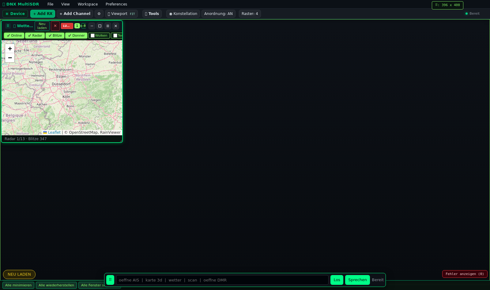
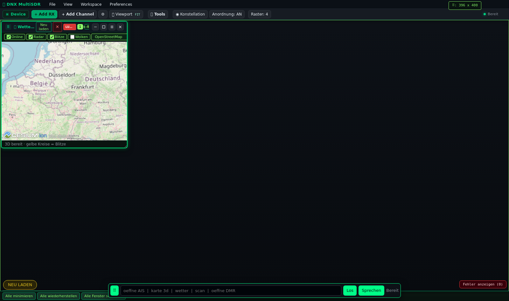
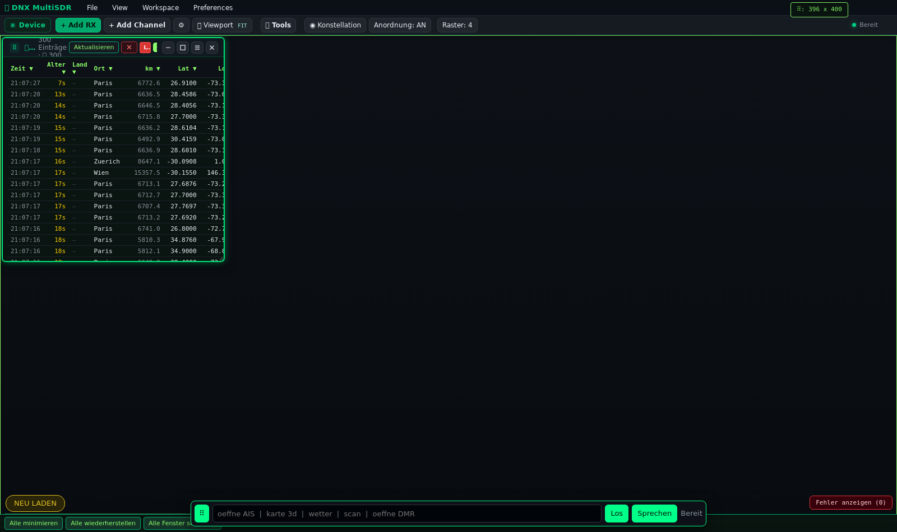
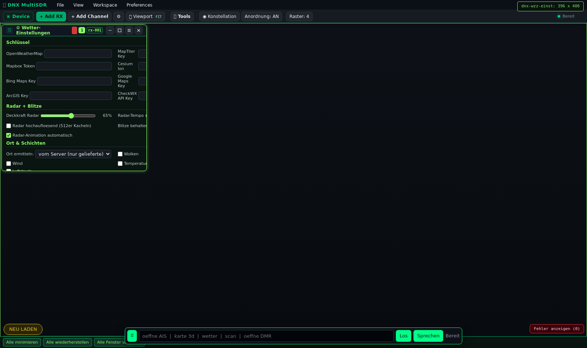
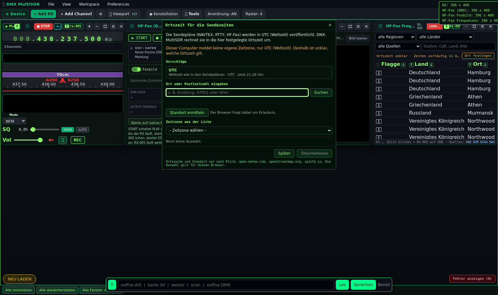
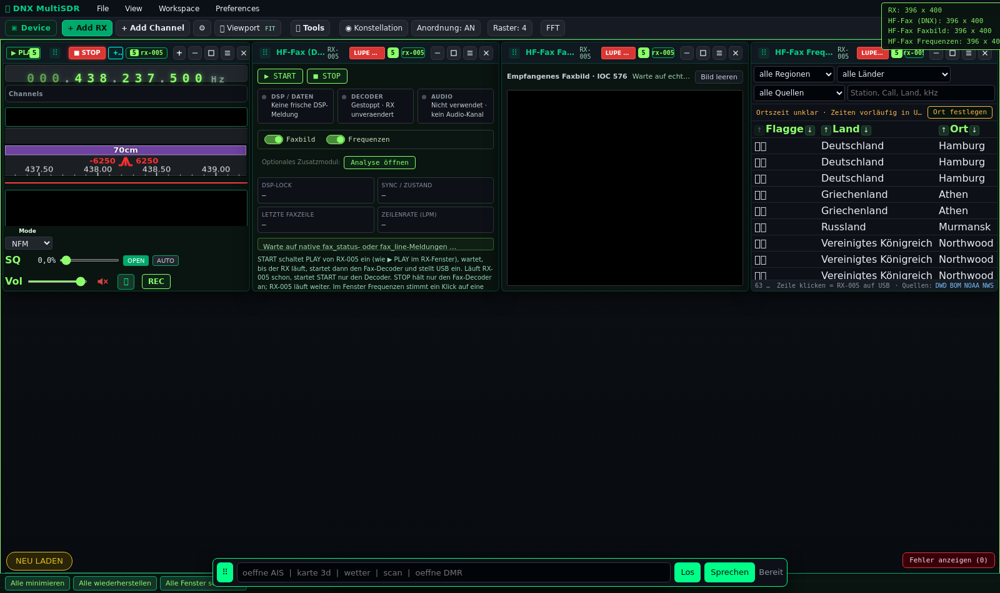

# Wetterzentrale (WZ) — vertieft

Die Wetterzentrale ist das größte Modul von DNX MultiSDR. Sie besteht aus
phänomenspezifischen Warn-Fenstern, Karten, einer Blitzdaten-Liste und einer
Einstellungs-/Schlüsselverwaltung. Daten kommen u. a. von DWD (Warnungen,
Messwerte, Regenradar, Blitze), Bright Sky, OpenStreetMap, RainViewer,
Open-Meteo und Cesium — Attribution wird in allen Ansichten mit eingeblendet.

## Die drei Gesichter der Wetter-Warnung

Alle Phänomen-Fenster (`Wind`, `Gewitter`, `Regen`, `Winter`, `Sonne & Sicht`)
teilen demselben Schema, nur die Prüfregeln und Richtwerte variieren:

- Header: Name + Quellen (`DWD-Warnungen · DWD-Messwerte`)
- Phänomen-Tabs (z. B. `Sturm | Starkwind | Böenfront | Orkan | Tornado | Downburst`)
- Blatt: **Warnungen** (Stand der amtlichen Warnung) und **Kennzahlen** (Messwerte)
- Statuszeile: `Ort: …` · `HH:MM · n Warnungen`
- Body: amtlicher Warntext oder `Keine amtliche Warnung für … in <Ort>` plus Richtwert
  ab wann eine Warnstufe gilt (z. B. `Wind-/Sturmböen ab 61 km/h`, `ab 10 mm in 1 h / 20 mm in 6 h`)
- Fußzeile: `Karte und Messreihe nur einmal: im Wetter…` und `auf Karte zeigen ↗`

Die Meldungen werden im 10-Minuten-Takt aktualisiert; für verbindliche Informationen
gilt ausschließlich der DWD bzw. die offiziellen Warnsysteme — siehe
[disclaimer.md](disclaimer.md).

### Kennzahlen-Tab (DWD-Messwerte)

Neben **Warnungen** hat jedes Phänomen-Fenster den Reiter **Kennzahlen**
(aktuelle DWD-Stationswerte: Wind/Böen, Blitzrate, Niederschlag/Summe, Temperatur/Taupunkt,
Frostdauer bzw. Feuchte/Tropennacht je nach Fenster). Die vier Fenster `Wind`,
`Gewitter`, `Regen` und `Winter` sowie `Sonne & Sicht` sind in
[add-channel.md](add-channel.md#kennzahlen-tab-dwd-messwerte) mit je einem
Screenshot dokumentiert. Wichtig fürs Verständnis: Werte unterhalb der
Warnschwellen werden als solche ausgewiesen (`unter der Warnschwelle`), und
fehlen Werte in der Quelle, erfindet die App keine (`kein erfundener Wert` —
ordentlich so).

## WZ-Karten (2D & 3D)

**2D** (`WZ · Karte 2D`) — Leaflet/OpenStreetMap-Basiskarte + Regenradar- und
Blitz-Ebenen; Schaltzeile mit Ebenen-Toggles (`Online · Radar · Blitze · Donner · Wolken · …`),
Blitz-Zähler (z. B. `Blitz 347`), Zeitregelung (`-7 … -2 min`) und Attribution
`© OpenStreetMap · RainViewer`.

**3D** (`WZ · Karte 3D`) — Cesium-basierter Globus (`Online · Radar · Blitze · Wolken · OpenStreetMap`);
gelbe Kreise markieren Blitzeinschläge, Buttons reißen Fliegen und Ebenen-Verwaltung auf.

## WZ · Wetterdaten (LI)

Ereignistabelle der Blitzeinschläge (Zeit, Alter, Land, Ort, Entfernung ab gewähltem
Bezugsort, Lat/Lon) — bis zu 500 Einträge, sortierbar, Aktualisieren + CSV.

## WZ · Einstellungen (EI)

- **API-Schlüssel** (alle leer ausgeliefert): OpenWeatherMap, Mapbox, Bing Maps,
  ArcGIS, MapTiler, **Cesium Ion** (für die 3D-Karten und 3D-Orbit/Weltall!),
  Google Maps, CheckWX. Was nicht gesetzt ist, läuft nur im eingeschränkten
  Gratis-Umfang. **Keys bleiben lokal in deinem Browser** — sie werden nirgendwo
  hochgeladen.
- **Radar + Blitze**: Deckkraft des Radars (`65 %`), Option `Radar hochauflösend
  (512er Kacheln)`, `Radar-Animation automatisch`, Blitz-Anzahl/Behalten.
- **Ort & Schichten**: `Ort ermitteln: vom Server (nur gelieferte …)` — der Server
  liefert den Standort, oder du setzt ihn manuell (`Ort/PLZ suchen` in der Welt-DB).
- **Ebenen**: Wolken, Wind, Temperatur, …
- Unten: `Alles neu laden` lädt die WZ-Module komplett neu.

## HF-Fax — Sendezeiten & UTC vs. MEZ

Die HF-Wetterkarten werden **in UTC** veröffentlicht; DNX MultiSDR rechnet auf
Wunsch in die festgelegte Ortszeit um. Beim ersten Öffnen fragt der Dialog
`Ortszeit für die Sendezeiten`:

- **UTC** — Weltzeit wie in den Sendeplänen (empfohlen, wenn du mit UTC arbeitest)
- **MEZ/Berlin** (Vorschlag des Servers) — Lokalzeit inkl. Sommer-/Winterzeit
- **Eigener Ortsname/PLZ** (open-meteo/OSM-Abfrage) oder manuelle Zeitzonenauswahl

Der Hinweis im Dialog: *"Ortssuche und Standort nur nach Klick; open-meteo.com,
openstreetmap.org, ipinfo.io. Die Auswahl gilt für diesen Browser."*

> **Praxis-Tipp DWD-Seefax (öffentlicher Sendeplan):** DDH3 3855 kHz (F1C, +425 Hz),
> DDK3 7880 kHz (−425 Hz), DDK6 13882,5 kHz; Übertragung: 120 UpM, IOC 576,
> Sendelängen ca. 19/20/11 Minuten, Sendezeiten in UTC. Die App kennt diese
> Frequenzen und Sendezeiten und markiert kommende Blöcke automatisch —
> siehe DWD „Sendeplan Seefax“ (dwd.de), dessen Angaben die App 1:1 abbildet.

> Der HF-Fax-Empfang braucht einen **aktiven RX** (z. B. RTL-SDR mit ausreichendem
> HF-Empfang über Konverter oder Langdraht). Der `DSP Test Source`-RX eignet sich
> nur als Layout-Probe — echte Faxbilder gibt es nur mit echten HF-Signalen.
> Zusätzliches Fenster `Analyse öffnen` (DSP-Einblicke) ist optional und öffnet sich
> nur auf Knopfdruck — es startet/ändert nichts am Dekoder.
